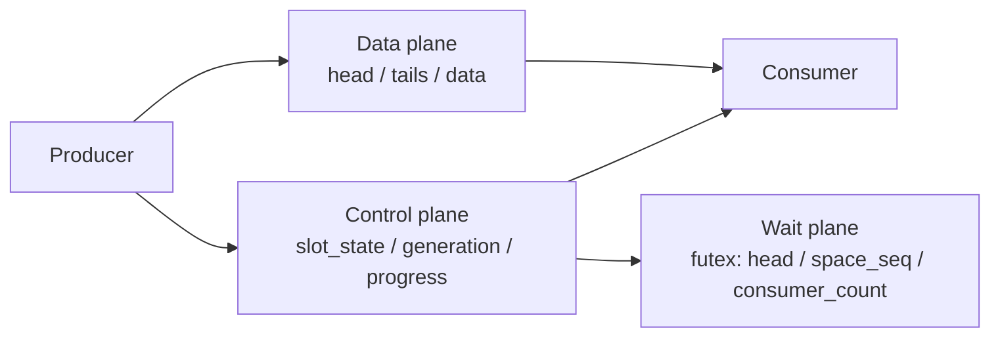
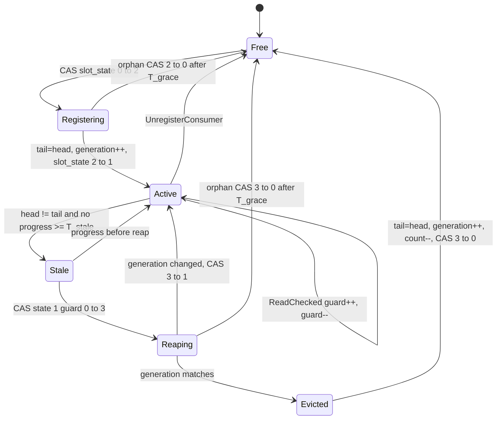

# 共享内存通信安全增强方案

> 版本: 0.3
> 日期: 2026-11-16
> 状态: 实施中, S0-S3、S5（不含 shell 桥接）、S6、S7 已完成, S4 适配器完成（基准未做）
> 范围: `include/osp/shm_transport.hpp`, `include/osp/data_dispatcher.hpp`, `include/osp/opt.hpp`, `include/osp/shell_commands.hpp`, `tests/test_shm_transport.cpp`, `docs/design_zh.md`, `docs/changelog_zh.md`
> 关联: `docs/design_minimal_safety_optimization_zh.md` 的 P0-4、P0-5
> 修订: 0.2 按 `docs/review_design_shm_comms_safety_zh.md` 的阻断项、高危项和主要中低项修订
> 修订: 0.3 按该评审第 9 节复审记录补齐验证矩阵的并发用例、`ReadLease`/`RevokeConsumer` 签名与头部增量口径

## 0. 结论先行

当前跨进程通信有四个安全缺口，按优先级处理:

| 编号 | 缺口 | 安全属性影响 | 处置 |
| --- | --- | --- | --- |
| P0-0 | 字节环长度前缀可整数溢出；零长度消息不推进 tail；`slot.size` 不可信；`WriteableBytes` 可下溢 | 可检测性缺失，内存安全与活性受损 | 先修 |
| P0-1 | SPMC 消费者崩溃后 `active` 不清零，生产者永久 `kFull` | 可检测性缺失，无恢复路径，写满后无界失败 | 本方案核心 |
| P1-1 | 写侧和消费者数量没有等待原语 | 有界等待缺失 | 补 futex 等待 |
| P1-2 | 大载荷双拷贝，块租约未接入通道 | 时延和 CPU 上界差 | 适配 DataDispatcher |

P0-0 和 P0-1 完成后，通道满足三条可验证承诺: 进程已死的消费者在 `T_reap_interval + T_scan` 内被检测并回收；写者最多重试一次即可恢复写入；所有扫描和等待都有编译期上限或截止时间。进程存活但长期不读的消费者只标记 stuck，不在默认配置下驱逐。P1-1 和 P1-2 是增强项，不阻塞 P0 发布。

本方案不引入统一 `RingCore`，不改变 AsyncBus 和 WorkerPool 的线程内模型。统一抽象留到 P2，且只在 MPSC 逻辑重复造成维护风险时启动。

## 1. 目标与非目标

### 1.1 目标

1. 把读者生命周期、等待和错误上报变成共享内存中的显式状态。
2. 每个故障都有检测点、恢复动作和量化上界。
3. 保持 header-only、C++17、`-fno-exceptions -fno-rtti`，热路径零堆分配。
4. 保持现有 API 可用，新行为通过配置启用，默认值对控制通道保守。

### 1.2 非目标

- 不完成 ISO 26262、IEC 61508 认证、HARA 或 SFMEA。本方案只提供组件级机制和证据。
- 不实现端到端 CRC。内容完整性见 `design_minimal_safety_optimization_zh.md` 的 P2-1。
- 不把 AsyncBus 改成跨进程总线，不把 WorkerPool 改成共享内存调度器。
- 不移除现有 polling API。`WaitReadable` 保留，新增 futex 路径。
- 不承诺多生产者 SPMC。SPMC 仍是单生产者契约，写者令牌只用于检测误用。

### 1.3 跨线程边界

本方案只改跨进程共享内存通道，线程内路径保持现状:

- AsyncBus 的有界性来自 `OSP_BUS_QUEUE_DEPTH`、`OSP_BUS_BATCH_SIZE` 和 `OSP_BUS_EVICT_SCAN_MAX`，可检测性来自 `BusHealthSnapshot` 和 `BusStatistics`，可恢复性来自 `DrainAndReset`。这些机制已经有测试覆盖。
- WorkerPool 的停止由 `Stop` 和 `Join` 保证，worker 队列是进程内 SPSC，不需要 generation、pid 或 futex。
- 统一 `RingCore` 放到 P2。只有 MPSC 逻辑重复导致维护风险时才启动。把线程内路径卷入本次安全改动，会扩大验证范围，不增加跨进程安全性。

## 2. 现状与差距

| 项 | 现状 | 差距 |
| --- | --- | --- |
| 读者注册 | `ShmSpmcByteRing::RegisterConsumer` 用 CAS 置 `active` (`shm_transport.hpp:1367`) | 无 generation；注册窗口内 `active=1` 早于 tail 初始化，生产者可能读到旧 tail |
| 慢消费者 | `SlowestTail` 读取 `tails[]` (`shm_transport.hpp:1481`) | 死消费者 tail 冻结，`WriteableBytes` 归零，无回收路径 |
| 写侧等待 | 只有 `WaitReadable` (`shm_transport.hpp:1691`)；`ShmChannel` 仍是轮询 (`:766`) | 写满只能轮询或返回 `kFull`，没有截止时间语义 |
| 长度校验 | `total = len + 4` (`shm_transport.hpp:942`)，`msg_len + 4` (`shm_transport.hpp:977`) | uint32 溢出可绕过容量检查；零长度消息不推进 tail |
| 可写空间 | `capacity - (head - slowest)` (`shm_transport.hpp:1418`) | `head - slowest > capacity` 时无符号下溢，返回接近 2^32 的可写字节数 |
| slot 长度 | `TryPop` 直接按 `slot.size` 执行 memcpy (`shm_transport.hpp:566`) | 共享内存损坏时按不可信长度越界 |
| 大载荷 | `ShmSpscByteRing::Write/Read` 两次 memcpy | DataDispatcher 的 `BlockGuard` (`data_dispatcher.hpp:808`) 未接入通道 |
| 健康视图 | 无 | 无 stale、reap、wait 统计，无法做安全监控 |

## 3. 目标架构

数据面、控制面、等待面分离。数据面保持现有环形缓冲算法，控制面承载读者生命周期，等待面只负责事件通知。



三个面的职责:

- 数据面: 只做索引推进和 memcpy，不判断读者死活。
- 控制面: 注册、回收、代际校验，所有状态都在共享内存或生产者本地。
- 等待面: futex 字和截止时间，不持有锁，不分配内存。

## 4. 控制面设计

### 4.1 共享内存布局 v2

`ShmSpmcByteRingHeader` 增加以下字段，`kShmLayoutVersion` 从 1 升到 2。版本 bump 是全局动作，`kSlotRing`、`kSpscByteRing`、`kSpmcByteRing` 的 v1 段都会 attach 失败，迁移清单见 13 节。版本 bump 单独提交，不与控制面逻辑混在一起。

`ShmLayoutHash` 增加 `header_payload_size` 参数，把 ring header 尺寸纳入哈希。仅靠 `total_size` 不足以发现“容量调小、头部变大”的布局互换。

```cpp
// ShmSpmcByteRingHeader v2. Existing head/capacity/max_consumers/consumer_count/tails omitted.
std::atomic<uint32_t> space_seq;       // consumer tail advance counter
std::atomic<uint32_t> reap_epoch;      // diagnostic: successful reap count
std::atomic<uint32_t> slot_state[N];   // low 2 bits state, high 30 bits guard
std::atomic<uint32_t> generation[N];   // per-consumer generation, 32-bit
std::atomic<uint32_t> flags[N];        // bit0 evicted, bit1 stale, bit2 stuck, bit3 corrupt
std::atomic<uint32_t> pid[N];          // owner pid for liveness check
// slot_state state: 0 free, 1 active, 2 registering, 3 reaping
// active[N] is replaced by slot_state[N], not kept alongside it.
```

`slot_state` 把状态和读到计数打包进同一个 32 位原子字，低位 2 位是 state，高位 30 位是 guard。消费者进入和写者回收都 CAS 同一个字，检查和执行之间不再有独立原子量的窗口。`static_assert(std::atomic<uint32_t>::is_always_lock_free)` 必须在编译期成立。

| 字段 | 写者 | 读者 | 内存序 | 用途 |
| --- | --- | --- | --- | --- |
| `slot_state` | 消费者 CAS guard，写者 CAS state | 双方 CAS | `acq_rel` | 状态与读计数 |
| `generation` | 注册、回收递增 | `ReadChecked`、`ReapStaleConsumers` | 写 release，读 acquire | 过期句柄识别 |
| `flags` | 写者置 evicted、stale、stuck、corrupt | `Health()`、诊断 | 写 release，读 relaxed | 故障标记 |
| `pid` | 注册写 `getpid()` | 写者存活检查 | 写 relaxed，读 acquire | 进程存活 |
| `tails` | 消费者推进，写者回收时置 head | 生产者 `SlowestTail` | 写 release，读 acquire | 读进度 |
| `consumer_count` | 注册、注销更新 | `WaitConsumers`、`Health()` | 写 release，读 acquire | 消费者数量 |
| `space_seq` | 消费者推进 tail 后递增 | `WaitWritable` | 写 release，读 acquire | 可写唤醒 |
| `reap_epoch` | 回收成功递增 | `Health()` | relaxed | 回收诊断 |

`last_progress_us` 不放进共享内存。SPMC 是单生产者，进度观察由写者本地完成，避免跨进程时钟域比较。写者本地维护四个定长数组:

```cpp
uint64_t observed_generation[OSP_SHM_SPMC_MAX_CONSUMERS];
uint32_t observed_tail[OSP_SHM_SPMC_MAX_CONSUMERS];
uint64_t last_progress_us[OSP_SHM_SPMC_MAX_CONSUMERS];
uint64_t transient_since_us[OSP_SHM_SPMC_MAX_CONSUMERS];  // state 2/3 orphan age
```

数据区容量不变。`slot_state[N]` 取代现有的 `active[N]`，头部净增为 `8 + 12N` 字节，其中 8 字节是 `space_seq` 与 `reap_epoch` 两个标量，`12N` 是 `generation`、`flags`、`pid` 三组数组。默认 N=8 时净增 104 字节，`sizeof(ShmSpmcByteRingHeader)` 由 80 增至 184，另有对齐填充。内存上界:

```text
RequiredSize(capacity, max_consumers)
  = sizeof(ShmLayoutHeader)
  + sizeof(ShmSpmcByteRingHeader)
  + capacity
```

不新增 `RequiredSize` 重载：新增字段是定长数组，随 `OSP_SHM_SPMC_MAX_CONSUMERS` 编译期固定，头部尺寸与运行时 `max_consumers` 无关，单参数 `RequiredSize(data_capacity)` 已覆盖全部内存。

SPMC 防覆盖的不变式是 `0 <= head - slowest <= capacity`。`WriteableBytes()` 必须做防御性钳位:

```cpp
const uint32_t used = head - slowest;
return (used >= capacity) ? 0U : (capacity - used);
```

`ShmSpscByteRing::WriteableBytes()` 同样钳位。任何推进、回退或回收 `tails[i]` 的路径都必须保持 `tails[i] >= head - capacity`，否则返回 `kCorrupt` 并停止写入。

### 4.2 注册流程

`RegisterConsumer(config)` 按以下顺序执行，扫描上限为 `max_consumers`:

1. CAS `slot_state[i]` 从 `state=0, guard=0` 到 `state=2, guard=0`，表示 registering。
2. 写 `tail[i] = head.load(acquire)`，`pid[i] = getpid()`，`generation[i] += 1`（release），`flags[i] = 0`。
3. CAS `slot_state[i]` 从 `state=2` 到 `state=1`（release），再执行 `consumer_count.fetch_add(1, release)`。
4. 返回 `ConsumerHandle{id, -1, generation[i]}`；租约通道由 `ShmLeaseChannel` 填入 `pool_slot`。

`SlowestTail()` 只统计 `slot_state` 低 2 位等于 1 的槽位，跳过 0、2、3。这样生产者不会在 tail 初始化前把新消费者当成慢消费者。注册的最坏执行时间是 O(max_consumers)，默认 8 次比较。

### 4.3 进度检测与回收

消费者每次 `ReadChecked` 按五步执行。一个 `ConsumerHandle` 同一时刻只允许一个读线程使用；多线程读取必须由调用方串行化。

1. CAS `slot_state[i]` 从 `state=1, guard=g` 到 `state=1, guard=g+1`。CAS 失败后重读该字: state 不为 1 返回 `kEvicted`；state 为 1 且 guard 非零说明同一句柄被两个线程同时读，返回 `kInvalidState` 并计入 `read_conflict_total`，不按驱逐计费。
2. 校验 `generation[i] == handle.generation`。不一致时递减 guard，返回 `kEvicted`。
3. 拷贝 payload。
4. 再次校验 `slot_state` 的 state 为 1 且 generation 匹配。不一致时丢弃结果，不提交 tail，递减 guard，返回 `kEvicted`。
5. 推进 tail，执行 `space_seq.fetch_add(1, release)` 和 `FutexWake(&space_seq)`，再 CAS 递减 guard。

第 4 步是评审指出的关键补充。只靠进入时校验不能阻止写者在拷贝期间把槽位切到 reaping，消费者必须在提交 tail 前再校验一次，失效时不能写 tail。

写者本地维护 `observed_generation`、`observed_tail`、`last_progress_us`、`transient_since_us` 四个定长数组。进度观察内联在 `ReapStaleConsumers(now_us)` 中，分四种情况:

- 仅对 `state == 1` 的槽位检查 `pid`。`pid` 不存活时立即标记 dead，不论 `head == tail`。空环时也能发现死消费者。
- generation 变化: 这是新消费者，重置 `observed_tail[i] = tails[i]`、`last_progress_us[i] = now`，本周期不判定 stale。
- tail 变化: 更新 `observed_tail[i]` 和 `last_progress_us[i]`。
- tail 不变且有积压: 计算停滞时长。超过 `stale_timeout_us` 只标记 stuck 嫌疑，并计入 `consumer_stuck_total`，不自动驱逐。

`ReapStaleConsumers(now_us)` 的处理顺序:

1. 若 `IsProcessAlive(pid[i]) == false`，进入 dead 回收。dead 进程的 guard 可能非零，但进程已不可能继续读，可以用 CAS 循环把 `slot_state` 置为 `state=3, guard=0`，并校验 generation，避免旧 pid 误杀已复用的新消费者。
2. 若该槽位已被标记 stuck，state 为 1，且 `evict_alive_slow` 为 true，CAS `state=1, guard=0 -> state=3, guard=0`。guard 非零时本周期 defer，`reap_deferred_total` 加一。
3. CAS 成功后重新读取 generation。若与 `observed_generation[i]` 不一致，用 CAS `state=3 -> state=1` 回滚，继续扫描。
4. generation 一致时执行回收: `tail[i] = head`、`generation[i] += 1`、`flags[i] |= evicted`、`consumer_count.fetch_sub(1, release)`、`space_seq.fetch_add(1, release)` 并 `FutexWake(&space_seq)`、`reap_epoch.fetch_add(1, relaxed)`。
5. 最后 CAS `state=3 -> state=0`，完成回收。

`state == 2` 和 `state == 3` 都可能因进程或线程异常退出而成为孤儿。`Tick()` 对超过 `T_grace` 的 `state == 2` 执行 CAS `2 -> 0` 并递增 generation；对超过 `T_grace` 的 `state == 3` 执行 CAS `3 -> 0`。正常注册和回收只有几次原子写，不会触及这两个分支。

检测和恢复的上界:

```text
T_scan   = 一次 ReapStaleConsumers 扫描，O(max_consumers)
T_write  = 一次 WriteChecked 路径，O(1) + 可选一次 T_scan

死进程检测 <= T_reap_interval + T_scan          // supervisor 模式
死进程检测 <= T_write + T_scan                   // on-full 模式
存活慢消费者标记 <= T_stale + T_reap_interval
恢复延迟 <= T_reap_interval + T_scan             // supervisor 模式
恢复延迟 <= T_scan                               // on-full 模式
```

默认 `T_stale = 3s`，与 `OSP_JOB_CONSUMER_TIMEOUT_US` 一致。`T_reap_interval` 默认 100ms，`T_grace` 默认 2s。`ShmChannelConfig` 默认 `reap_policy = kNone`。`ShmSpmcByteChannel` 构造时显式填 `kOnFull`，硬实时调用方改为 `kSupervisor` 并周期调用 `Tick()`。`evict_alive_slow` 默认 false，只有传感器分发等明确接受慢消费者丢失的通道才打开。

`slot_state` 的 guard 取代了独立的 `read_guard`，每次 `ReadChecked` 增加两次 CAS。单读者契约下 guard 最大为 1，不会溢出；多线程共用一个 handle 属于调用方错误，不在支持范围。

### 4.4 生产者写入策略

`WriteChecked` 的快速路径只做四件事: 长度校验、容量检查、拷贝、发布 head。写满时的行为由 `ReapPolicy` 决定:

| 策略 | 行为 | 适用场景 | 最坏执行时间 |
| --- | --- | --- | --- |
| `kNone` | 返回 `kFull`，不扫描 | 控制通道，硬实时 | O(1) |
| `kOnFull` | `WriteChecked` 内部调用 `ReapStaleConsumers`，扫描一次，重试一次 | 简单部署，无监督线程 | O(max_consumers) |
| `kSupervisor` | `WriteChecked` 不扫描，由外部周期调用 `Tick()` | 硬实时，需配套 Tick | O(1) |

本次只实现 `ReapPolicy`。通道层不提供 `DropOldest`、`EvictSlowConsumer`、`Block` 三种溢出策略，写满一律返回 `kFull` 并计入 `write_stall_events` 与 `dropped_newest`；需要覆盖旧数据的业务在应用层自行丢弃后重写。写侧因此只有 `reap_policy` 与 `evict_alive_slow` 两个开关: 控制通道用 `kNone`，传感器分发用 `kOnFull`，硬实时改 `kSupervisor` 并由外部周期调用 `Tick()`。

### 4.5 消费者被驱逐后的恢复

`ReadChecked` 在进入和提交前各校验一次 `slot_state` 与 `generation`。任一次失败返回 `kEvicted`，不读取或丢弃已读数据，不推进 tail。按 id 的 `Read(int32_t, ...)`、`RegisterConsumer()`、`UnregisterConsumer(int32_t)` 已移除，本次不做源码兼容。

调用方的恢复路径是 `Reopen(handle, config)`:

1. `UnregisterConsumer(handle)` 幂等执行，旧代际已失效时直接返回成功。
2. `RegisterConsumer(config)` 获得新 id 和新 generation。
3. 新消费者从当前 head 开始，跳过错过的数据。

`Reopen` 由库提供，内部组合上面两步，返回新的 `ConsumerHandle`。库不在 `ReadChecked` 内部自动重注册，避免隐藏循环和不可观测的数据丢失。`kEvicted` 必须经 `FaultReporter` 上报，并计入 `evicted_total`。

### 4.6 消费者状态机



`Stale` 是写者观察到的派生状态，不写入共享内存。`slot_state` 的 guard 是 `Active` 内部的微状态，不单独建状态。共享内存只记录 `slot_state`、`generation`、`tail`、`flags`、`pid`，减少跨进程状态同步点。

## 5. 等待面设计

### 5.1 等待字

| 等待字 | 生产者动作 | 消费者动作 | 用途 |
| --- | --- | --- | --- |
| `head` | 发布消息后 `FutexWakeAll` | `FUTEX_WAIT` 等 head 变化 | SPMC 广播可读 |
| `space_seq` | `FUTEX_WAIT` 等它变化 | 推进 tail 后 `fetch_add` 并 `FutexWake` | 空间可写 |
| `consumer_count` | `FUTEX_WAIT` 等它变化 | 注册或注销后 `fetch_add/fetch_sub` 并唤醒 | 等待 N 个消费者 |

三个字都是 32 位原子，满足 `sizeof(std::atomic<uint32_t>) == sizeof(uint32_t)`，可直接作为 futex 地址。现有 `FutexWait/FutexWake/FutexWakeAll` (`shm_transport.hpp:1057`、`:1066`、`:1072`) 复用，不新增系统调用封装。

`head` 是广播字，一条消息可能对应多个消费者，发布后必须 `FutexWakeAll`。`space_seq` 是单写者字，唤醒一个写者即可。`consumer_count` 在注册或注销时变化，使用 `FutexWakeAll`。

### 5.2 API

```cpp
expected<void, ShmError> WaitReadable(uint32_t timeout_ms) noexcept;   // existing
expected<void, ShmError> WaitWritable(uint32_t needed, uint32_t timeout_ms) noexcept;  // new
expected<void, ShmError> WaitConsumers(uint32_t count,
                                       uint32_t timeout_ms) noexcept; // new
```

`WaitWritable` 的循环结构:

```cpp
const uint64_t deadline = SteadyNowUs() + timeout_ms * 1000ULL;
for (;;) {
  const uint32_t wire = needed + 4;  // payload plus length prefix
  if (WriteableBytes() >= wire) return success();
  const uint32_t seq = space_seq.load(acquire);
  if (WriteableBytes() >= wire) return success();
  const uint32_t remaining_ms = RemainingMsCeil(deadline);
  if (remaining_ms == 0) return error(kTimeout);
  const int rc = FutexWait(&space_seq, seq, remaining_ms);
  if (rc == 0 || errno == EAGAIN) continue;
  if (errno == EINTR) continue;
  if (errno == ETIMEDOUT) return error(kTimeout);
  return error(kWaitInterrupted);
}
```

循环由 deadline 约束，每次迭代最多一次 futex 系统调用。`EAGAIN` 表示值已变化，重新检查谓词。`EINTR` 重新计算剩余时间，不重置 deadline。`ETIMEDOUT` 必须映射为 `kTimeout`，不能落入 `kWaitInterrupted`。`RemainingMsCeil` 向上取整，避免 1ms 级超时被截断为 0。`timeout_ms == 0` 退化为 try-once，不进入系统调用。

`WaitReadable` 的顺序必须是“读 head 旧值、检查谓词、以旧值进入 `FUTEX_WAIT`”。现有 `ShmSpmcByteChannel::WaitReadable` (`shm_transport.hpp:1691`) 先查谓词后读 head，存在迟唤醒，必须一并修正。`WaitConsumers` 使用相同的读计数、检查、等待顺序。

`ShmChannel` 的 MPSC slot ring 仍使用轮询 (`shm_transport.hpp:766`)，本次只修 SPMC 和 byte channel 的 futex 路径。MPSC 的 futex 化不在本方案范围，避免把 slot ring 的布局和等待面一起改动。

### 5.3 有界性与丢唤醒防护

- 可选自旋: `OSP_SHM_WAIT_SPIN_US` 默认 50us，最大 1ms。自旋只读内存，不增加系统调用。
- 无界禁止: 不允许 `while (true)` 不带 deadline；`WaitConsumers` 的 count 必须小于等于 `max_consumers`。
- 丢唤醒防护: 状态变更使用 release，`space_seq.fetch_add` 在 tail 发布之后；等待方先读 seq，再检查谓词，再以旧 seq 进入 `FUTEX_WAIT`。值已变化时内核返回 `EAGAIN`，等待方重新检查。
- 广播语义: `WaitReadable` 使用 `FutexWakeAll` 唤醒全部 SPMC 读者；`WaitWritable` 唤醒一个写者；`WaitConsumers` 在 count 变化时使用 `FutexWakeAll`。
- 超时语义: `FUTEX_WAIT` 的 `ETIMEDOUT` 返回 `kTimeout`，`EAGAIN` 重新检查，`EINTR` 重算剩余时间，其余错误返回 `kWaitInterrupted`。

## 6. 大载荷租约

### 6.1 数据格式

通道只传 16 字节索引，不传大块数据:

```cpp
struct ShmBlockRef {
  uint32_t block_id;
  uint32_t block_generation;
  uint32_t size;
  uint32_t pool_hash;
};
static_assert(sizeof(ShmBlockRef) == 16, "ShmBlockRef must be 16 bytes");
```

`ReadLease()` 返回 `expected<BlockLease, ShmError>`。`BlockLease` 是 move-only RAII 句柄，提供 `Data()`、`Size()`、`Id()`、`Generation()`，析构时递减引用计数。

### 6.2 与 DataDispatcher 的复用

不新建第二个块池，复用 `DataDispatcher` 的分配、引用计数与回收路径:

1. 生产者调用 `ShmLeaseProducer::Publish`，内部 `Alloc()` 取块、`GetWritable()` 写入、`AddRef(consumer_count)` 设置引用计数。
2. 发布前对每个消费者池槽位 `TrackBlockHold`，覆盖“已计入引用计数但尚未取得租约就崩溃”的泄漏路径。
3. 通道只传 16 字节 `ShmBlockRef`；消费者 `ShmLeaseConsumer::ReadLease` 用 `GetReadable(id, generation)` 做代际校验，失配返回 `kEvicted`。
4. `BlockLease` 析构时 `Release(id, generation)` 并 `TrackBlockRelease`，最后一个引用触发 `Recycle`。
5. 消费者被驱逐或确认停止后调用 `DataDispatcher::RevokeConsumer(pool_slot)`，扫描 `holding_mask` 逐个 `Release` 并注销池槽位。

限制: 生产者必须持有消费者池槽位列表（由部署的注册层提供），通道不自带“通道 id 到池槽位”的共享映射；`Publish` 拒绝越界槽位并对重复槽位去重，保证引用计数与 hold 位一一对应。租约析构与 `RevokeConsumer` 通过 `holding_mask` 的位所有权互斥：谁先清位谁负责 `Release`，并发时也只释放一次。持有租约超过 `OSP_JOB_CONSUMER_TIMEOUT_US`（3s）必须周期调用 `ShmLeaseConsumer::Heartbeat()`，否则生产者的 `CleanupDeadConsumers` 可能回收该块。

上界: `holding_mask` 受 `MaxBlocks <= 64` 约束，消费者数受 `OSP_JOB_MAX_CONSUMERS` 约束（默认 8），单块大小受 `BlockSize` 约束。三个上界独立，不能互相替代。所有上界编译期固定，没有运行时扩容。

### 6.3 兼容与验收

- 拷贝路径（`Write` + `ReadChecked`）保留，租约路径是新增 API。
- 租约是模板适配器，未实例化不生成代码，因此不设 `OSP_SHM_ENABLE_LEASE` 开关。
- 验收正确性: 租约发布/消费/回收、`RevokeConsumer` 回收已覆盖；跨进程 `SIGKILL` 后的 `ScanTimeout` 回收未单独验证。
- 验收基准: 1MB 载荷、2 个消费者、2000 次；Release 下拷贝路径 224.4us/迭代，租约路径 73.6us/迭代，详见 `docs/benchmark_report_zh.md` §10。

## 7. P0-0: 长度与损坏消息防御

字节环的 `[4B 长度][payload]` 格式必须先验证再运算，禁止先做 `len + 4`:

| 检查点 | 规则 | `WriteChecked` / `ReadChecked` 返回 |
| --- | --- | --- |
| 写入长度 | `len != 0` | `kInvalidArgument` |
| 写入长度 | `len <= Capacity() - 4` | `kMessageTooLarge` |
| 读取头 | `available >= 4` | 无数据，返回 0 |
| 读取长度 | `msg_len != 0` | `kCorrupt` |
| 读取长度 | `msg_len <= available - 4` | `kCorrupt` |
| 读取长度 | `msg_len <= max_len` | `kMessageTooLarge` |
| slot 读取 | `slot.size <= SlotSize` | `kCorrupt` |

零长度消息不再允许写入。若业务需要空消息，使用 1 字节哨兵或上层协议表达，避免 `Read` 因 `msg_len == 0` 不推进 tail 造成永久阻塞。

损坏消息不推进 tail，置 `flags |= corrupt`，返回 `kCorrupt`。恢复路径只有两条: 所有端点停止后 `ResetAfterQuiesce()`，或 owner 已死时 `CreateOrReplaceWriter()`。不允许跳过损坏消息继续读，否则后续边界无法证明。

`ShmSpscByteRing` 和 `ShmSpmcByteRing` 共用同一套校验函数，避免两份实现漂移。测试使用长度 `0`、`1`、`Capacity()-4`、`Capacity()-3`、`UINT32_MAX` 和 1M 次随机长度，ASan 下不得出现越界。`Write` 保留为布尔快速路径；SPMC 读路径只有 `ReadChecked`，错误通过 `ShmError` 返回。

`ShmRingBuffer::TryPop` 也要校验 `slot.size <= SlotSize`。共享内存可能被外部进程或旧版本写坏，不能按不可信的 `slot.size` 执行 memcpy。校验失败置 corrupt 标志并返回 false，不释放 slot；`Health()` 报告 `kCorrupt`，恢复仍走 `ResetAfterQuiesce`。

`ShmRingBuffer` 头部增加 `std::atomic<uint32_t> fault_flags`，与 SPMC 共用 `kShmLayoutVersion = 2`。旧段 attach 返回 `kLayoutMismatch`，不做静默解释。MPSC 是本次实际改动的段；SPSC 没有头部改动，但被全局版本 bump 连带作废，迁移成本在 13 节列明。

## 8. 安全属性映射

| 属性 | 机制 | 量化指标 | 验收 |
| --- | --- | --- | --- |
| 可检测 | generation 校验、tail 停滞、slot_state guard、pid 存活、长度校验、layout hash、lease 计数、wait 超时 | `stale_consumers`、`reaped_total`、`evicted_total`、`reap_deferred_total`、`consumer_stuck_total`、`write_stall_events`、`wait_timeouts` | `Health()` 可读，`FaultReporter` 有事件 |
| 可恢复 | `ReapStaleConsumers`、`Reopen`、`CreateOrReplaceWriter`、`CleanupDeadConsumers` | 恢复耗时、恢复后写入成功率 | 死消费者用例在 `T_reap_interval + T_scan` 内恢复 |
| 有界 | 固定 `max_consumers`、固定块池、deadline 等待、O(N) 扫描、零堆分配 | 扫描次数、等待系统调用次数、内存公式 | 代码审查加基准测试 |

可检测的默认上报路径是 `ShmFaultReporter` 函数指针，不直接依赖 `fault_collector.hpp`。使用方在初始化时把事件桥接到 `FaultCollector`，保持头文件依赖最小。

`FaultReporter` 只在状态迁移时调用，例如进入 stale、evicted、stuck、faulted。`kFull` 和 `kTimeout` 只累加计数，不在每次失败时回调，避免热路径被日志或故障队列拖慢。

安全状态定义: 检测到 `kCorrupt` 或 generation 耗尽时，`Health().state` 报 `kFaulted`。本次不在写路径上强制拦截（`WriteChecked` 不检查 `Health().state`），调用方须在收到 fault 后停止写入并选择恢复路径: 所有端点停止后 `ResetAfterQuiesce()`，或 owner 已死时 `CreateOrReplaceWriter()`。写闸门留待需要时再加，避免热路径多一次原子读。

`Health().state` 的三档定义: `kHealthy` 表示无 stale、无 orphan、无 corrupt；`kDegraded` 表示出现 stuck、defer 或 orphan，但自动恢复仍可能成功；`kFaulted` 表示 corrupt、layout mismatch、generation wrap 或恢复截止时间已过，必须人工重置或替换段。`last_error` 记录最近一次进入 `kFaulted` 的错误码。

安全需求追溯:

| 需求 ID | 安全需求 | 设计落点 | 验证 |
| --- | --- | --- | --- |
| SR-01 | 字节环写入不得因长度运算溢出 | 第 7 节校验规则 | oversize、corrupt、ASan |
| SR-02 | 死消费者在 `T_reap_interval + T_scan` 内被检测 | 4.3 pid 存活检查 | dead consumer |
| SR-03 | 回收不得产生跨世代 tail 写，也不得覆盖正在拷贝的 payload | 4.3 `slot_state` guard 与提交前重校验 | reap race、stuck consumer |
| SR-04 | 写满等待必须有截止时间 | 5.2 `WaitWritable` | wait timeout |
| SR-05 | 大载荷租约在消费者崩溃后回收 | 6.2 `RevokeConsumer` | crash reclaim |
| SR-06 | 布局不一致必须拒绝 attach | 4.1 版本和 `layout_hash` | layout mismatch |
| SR-07 | 故障必须可上报 | 8、10 节 `FaultReporter` | `Health()` 和事件用例 |
| SR-08 | 不得静默丢数据 | 4.4 默认 `DropNewest`，8 节 `Faulted` | 控制通道默认配置审查 |
| SR-09 | `WriteableBytes` 不得下溢 | 4.1 不变式、`WriteableBytes` 钳位 | 下溢用例 |
| SR-10 | 回收与新注册并发时不得误杀新消费者 | 4.3 `state=3` CAS 回滚 | reap race 循环用例 |

## 9. 故障处置表

| 故障 | 检测信号 | 检测上界 | 恢复动作 | 升级 |
| --- | --- | --- | --- | --- |
| 消费者进程已死 | `IsProcessAlive(pid) == false` | `T_reap_interval + T_scan` | 回收槽位，写者重试一次 | `evicted_total` 增长，上报 fault |
| 消费者暂停 | pid 存活，tail 停滞 | `T_stale + T_reap_interval` | 只标记 stuck；`evict_alive_slow` 为 true 才回收 | 人工确认，避免误杀 |
| 消费者读中挂起 | `slot_state` guard 非零且 state 为 1 | `T_stale + T_grace` | 延迟回收，置 stuck，不覆盖 payload | 上报 `kConsumerStuck`，要求外部恢复 |
| 同句柄并发读 | 消费者 CAS `slot_state` 失败且 state 仍为 1 | 立即 | 返回 `kInvalidState`，计入 `read_conflict_total`，不驱逐 | 调用方串行化同一句柄 |
| 注册中断 | `state == 2` 超过 `T_grace` | `T_grace + T_scan` | CAS `2 -> 0`，generation++ | 上报 orphan 计数 |
| 回收中断 | `state == 3` 超过 `T_grace` | `T_grace + T_scan` | CAS `3 -> 0` | 上报 orphan 计数 |
| 写者崩溃 | owner_pid 不存活 | attach 时立即 | `CreateOrReplaceWriter` | owner 存活时返回 `kOwnerAlive` |
| 长度损坏 | 长度校验失败 | 立即 | 置 corrupt，停止该消费者 | `ResetAfterQuiesce` 或替换段 |
| 可写空间下溢 | `head - slowest > capacity` | 立即 | 钳位为 0 并停止写入（本次不置 corrupt） | `ResetAfterQuiesce` 或替换段 |
| 布局不一致 | magic、version、layout_hash 不符 | attach 时立即 | 返回 `kLayoutMismatch` | 拒绝 attach，不静默解释 |
| 块池耗尽 | `free_count == 0` | 分配时立即 | 返回 `JobPoolError::kPoolExhausted`（S4 未实现） | 背压，检查租约泄漏 |
| 租约泄漏 | `alloc_count` 长期不降 | `ScanTimeout` 周期 | `CleanupDeadConsumers`、超时回收 | 上报 fault，隔离消费者 |
| 等待超时 | deadline 到期 | `timeout_ms` | 返回 `kTimeout` | 调用方重试、降级或停机 |

`ReapPolicy::kNone` 下，dead/stuck/orphan 行只更新 `Health()` 和计数器，不自动回收。上表中的恢复动作以 `kOnFull` 或 `kSupervisor` 为前提。

## 10. API 与错误码

```cpp
enum class ShmError : uint8_t {
  kCreateFailed = 0,
  kOpenFailed,
  kMapFailed,
  kFull,
  kEmpty,
  kTimeout,
  kClosed,
  kAlreadyExists,
  kLayoutMismatch,
  kOwnerAlive,
  // appended in v0.2
  kInvalidArgument,
  kInvalidState,
  kEvicted,
  kConsumerStuck,
  kCorrupt,
  kMessageTooLarge,
  kWaitInterrupted,
  kNone,
};

enum class ReapPolicy : uint8_t { kNone, kOnFull, kSupervisor };
enum class ShmState : uint8_t { kHealthy, kDegraded, kFaulted };

struct ConsumerHandle {
  uint32_t id;
  int32_t pool_slot;       // -1 when lease is disabled
  uint32_t generation;
};

struct ShmChannelConfig {
  uint64_t stale_timeout_us{3000000};
  uint32_t reap_interval_ms{100};
  uint32_t grace_us{2000000};
  ReapPolicy reap_policy{ReapPolicy::kNone};
  bool evict_alive_slow{false};
};

struct ShmHealthSnapshot {
  ShmState state{kHealthy};
  ShmError last_error{kNone};
  uint64_t reap_epoch{0};
  uint32_t active_consumers{0};
  uint32_t stale_consumers{0};
  uint64_t oldest_pending_us{0};
  uint64_t reaped_total{0};
  uint64_t evicted_total{0};
  uint64_t reap_deferred_total{0};
  uint64_t read_conflict_total{0};
  uint64_t consumer_stuck_total{0};
  uint64_t orphan_state2_total{0};
  uint64_t orphan_state3_total{0};
  uint64_t generation_wrap_total{0};
  uint64_t write_stall_events{0};
  uint64_t wait_timeouts{0};
  uint64_t corrupt_total{0};
  uint64_t dropped_newest{0};
};

struct ShmFaultEvent {
  uint16_t code;
  uint32_t channel_hash;
  uint32_t consumer_id;
  uint64_t detail;
};

using ShmFaultReporter = void (*)(const ShmFaultEvent&, void* ctx);
```

新增方法:

```cpp
expected<ConsumerHandle, ShmError> RegisterConsumer(const ShmChannelConfig&) noexcept;
expected<void, ShmError> UnregisterConsumer(ConsumerHandle) noexcept;
expected<ConsumerHandle, ShmError> Reopen(ConsumerHandle, const ShmChannelConfig&) noexcept;
expected<uint32_t, ShmError> ReadChecked(ConsumerHandle, void* out, uint32_t max_len) noexcept;
expected<BlockLease, ShmError> ReadLease(ConsumerHandle, uint32_t timeout_ms) noexcept;  // ShmLeaseChannel
void RevokeConsumer(int32_t pool_slot) noexcept;  // ShmLeaseChannel: scan holding_mask
expected<void, ShmError> WriteChecked(const void* data, uint32_t len) noexcept;
expected<void, ShmError> WaitWritable(uint32_t needed, uint32_t timeout_ms) noexcept;
expected<void, ShmError> WaitConsumers(uint32_t count, uint32_t timeout_ms) noexcept;
expected<void, ShmError> Tick(uint64_t now_us, const ShmChannelConfig& = {}) noexcept;  // supervisor mode
uint32_t ReapStaleConsumers(uint64_t now_us, const ShmChannelConfig& = {}) noexcept;
expected<void, ShmError> ResetAfterQuiesce() noexcept;
ShmHealthSnapshot Health() const noexcept;
void SetFaultReporter(ShmFaultReporter reporter, void* ctx) noexcept;

// 租约适配器（模板，未实例化不生成代码）
template <typename DispatcherT> class BlockLease;        // Data/Size/Id/Generation, RAII
template <typename DispatcherT> class ShmLeaseProducer;  // Publish(data, size, pool_slots, count)
template <typename DispatcherT> class ShmLeaseConsumer;  // ReadLease/Heartbeat/Revoke
```

按 id 的旧 SPMC 接口已移除，不存在重载歧义：注册返回 `ConsumerHandle`，读取走 `ReadChecked`。`Write` 保留布尔快速路径，`WriteChecked` 提供错误码与 `kOnFull` 回收重试。

`ResetAfterQuiesce()` 要求写者独占且所有消费者已注销。它重置 head、tails、slot_state、consumer_count、space_seq，并递增每个槽位的 generation。条件不满足返回 `kInvalidState`，不强行重置；任一 generation 已达 `UINT32_MAX` 时同样返回 `kInvalidState`，要求替换段。重置分两阶段：先快照 generation，再把包括空闲槽在内的全部槽位 CAS 到 `state=3`；任一槽位在此期间被注册、注销或读取导致 CAS 或 generation 复核失败时，整体回滚并返回 `kInvalidState`，不会留下部分清空的槽位。`Reopen` 组合 `UnregisterConsumer` 与 `RegisterConsumer`，返回新句柄。`Tick()` 是 `ReapStaleConsumers`、`state == 2` 孤儿清理和 `state == 3` 孤儿清理的组合入口。

`ShmError` 只追加，既有 0 到 9 的值不变。`Health()` 是 lock-free 快照，不分配内存，可在 shell 命令或看门狗周期调用。块池错误仍由 `JobPoolError` 表达，租约相关映射随 S4 定义。

`now_us` 必须来自 `SteadyNowUs()`，只在写者进程内使用，不跨进程比较。`generation` 为 32 位，注册时若 `generation == UINT32_MAX`，返回 `kInvalidState` 并递增 `generation_wrap_total`，要求走 `ResetAfterQuiesce` 或 `CreateOrReplaceWriter`，不允许静默回绕。

## 11. 实施计划

| 编号 | 优先级 | 改动 | 文件 | 工作量 |
| --- | --- | --- | --- | --- |
| S0 | P0-0 | 写目标行为的失败测试（RED），覆盖零长度、oversize、slot size、下溢 | `tests/test_shm_transport.cpp` | S |
| S1 | P0-0 | 长度校验、零长度拒绝、corrupt 标志、`WriteableBytes` 钳位 | `include/osp/shm_transport.hpp` | S |
| S1b | P0-0 | 布局 v2、`ShmLayoutHash` 增加 header size 参数、attach 校验，单独 ABI 提交 | `include/osp/shm_transport.hpp` | S |
| S2 | P0-1 | `slot_state` 打包、generation、pid、进度检测、孤儿清理、`ReadChecked` | `include/osp/shm_transport.hpp` | M |
| S3 | P1-1 | `space_seq`、`WaitWritable`、`WaitConsumers`、`WaitReadable` 顺序修正、`FutexWakeAll`、`ETIMEDOUT` 映射 | `include/osp/shm_transport.hpp`、`include/osp/opt.hpp` | M |
| S4 | P1-2 | `ShmBlockRef`、`ReadLease`、复用 `holding_mask`、id 映射、块池 attach 返回错误 | `include/osp/shm_transport.hpp`、`include/osp/data_dispatcher.hpp`、`include/osp/opt.hpp` | L |
| S5 | P1-1 | `Health()`、`ShmFaultReporter`、shell 命令桥接 | `include/osp/shm_transport.hpp`、`include/osp/shell_commands.hpp` | S |
| S6 | 兼容 | 移除按 id 的旧 SPMC API，`OpenReader`/示例/测试改用句柄 | `include/osp/shm_transport.hpp`、`tests/test_shm_transport.cpp`、`examples/data_dispatcher/*` | M |
| S7 | 文档 | 同步 `docs/design_zh.md` 7.5 节、`docs/changelog_zh.md` | `docs/design_zh.md`、`docs/changelog_zh.md` | S |

S0 必须先失败，但用例断言的是目标行为，不是现状。例如“零长度写入返回 `kInvalidArgument`”“`len=UINT32_MAX-3` 返回 `kMessageTooLarge`”“`slot.size > SlotSize` 返回 `kCorrupt`”。修复前这些断言失败，修复后通过，才能证明修的是缺陷而不是把现状写进测试。

实施进度（2026-11-16）: S0、S1、S1b、S2、S3、S5、S6、S7 已落地，S4 租约适配器与基准已完成。S0 与 S1 修复长度回绕、零长度与 `WriteableBytes` 下溢，7 条用例在 HEAD 头文件下 6 条失败、修复后通过。S1b 完成 `kShmLayoutVersion = 2`、`ShmLayoutHash` 增加 `header_payload_size`、MPSC 头部增加 `fault_flags` 并在 slot 长度损坏时置位、v1 段 attach 返回 `kLayoutMismatch`。S2 完成 `slot_state` 打包、`generation`、`pid` 存活检测、`Tick`/`ReapStaleConsumers`、`WriteChecked` 的 `kOnFull` 重试、`ReadChecked`、`Reopen`、`ResetAfterQuiesce`，健康消费者只标 stuck，`evict_alive_slow` 才回收。S3 完成 `space_seq` 计数与唤醒、`WaitWritable(needed, timeout)`、`WaitConsumers`、`WaitReadable` 的“先读字再校验再等待”顺序、`ETIMEDOUT` 到 `kTimeout` 的映射与 `OSP_SHM_WAIT_SPIN_US`。S5 完成 `ShmHealthSnapshot`/`Health()`、`ShmFaultReporter` 与 `SetFaultReporter`、stuck/orphan/corrupt/wrap 的计数与上报；shell 命令桥接暂缓，当前仓库没有可挂接的通道注册表，强行新增会引入全局单例。S6 按“不做源码兼容”删除按 id 的 SPMC 接口，`ShmSpmcByteChannel` 内部改用 `ConsumerHandle`/`ReadChecked`/`WriteChecked`，示例与测试同步迁移。S7 已同步 `docs/design_zh.md` 7.5 与 `docs/changelog_zh.md`。`[shm][safety]` 共 48 条；ASan 48 条、TSan `~[fork]` 44 条、全量 1410 条用例均无失败。

复核（2026-11-16）: 15 节完成定义已按实际状态重勾；未完成项为 shell 健康命令。`[shm][safety]` 增至 48 条，补 generation wrap、write stall、orphan 计数与 read conflict 计数的直接断言。

S2 的实现顺序固定为五步:

1. 头部加 `slot_state`、`generation`、`flags`、`pid`、`space_seq`、`reap_epoch`；`generation` 固定 32 位。
2. `RegisterConsumer` 改为 `0 -> 2 -> 1` 注册，`SlowestTail` 只统计 state 1。
3. 写者本地加 `observed_generation`、`observed_tail`、`last_progress_us`，在 `ReapStaleConsumers` 内联 pid 存活检查与停滞判定。
4. 实现 `ReapStaleConsumers`，主路径 CAS `state=1, guard=0 -> 3`；dead 进程走独立路径；补 `state=2/3` 孤儿清理。
5. `ReadChecked` 加 guard CAS 与提交前重校验，返回 `kEvicted`；补 `Reopen` 用例。

S4 的实现顺序固定为四步:

1. 定义 `ShmBlockRef` 和 `BlockLease`，先只支持单消费者。
2. 接 `DataDispatcher::AllocGuard`，发布时设置引用计数并对活跃消费者调用 `TrackBlockHold`。
3. 接 `CleanupDeadConsumers` 和 `RevokeConsumer`，补齐崩溃回收用例；明确通道 id 与 `pool_slot` 映射。
4. 加 2 消费者和 1MB 基准，确认引用计数、`holding_mask` 与释放次数一致。

## 12. 验证矩阵与命令

| 用例 | 场景 | 期望 | 上界 |
| --- | --- | --- | --- |
| `shm_safety - zero length` `[shm][safety]` | 写入零长度 | 返回 `kInvalidArgument` | 立即 |
| `shm_safety - oversize` `[shm][safety]` | 长度 `Capacity()-3` | 返回 `kMessageTooLarge` | 立即 |
| `shm_safety - oversize fork` `[shm][safety][fork]` | 长度 `UINT32_MAX-3` | 修复前子进程被信号终止；修复后通过 pipe 回传 `kMessageTooLarge` 并正常退出 | 立即 |
| `shm_safety - corrupt length` `[shm][safety]` | 手工写入非法长度 | 返回 `kCorrupt`，不推进 tail | 立即 |
| `shm_safety - corrupt slot size` `[shm][safety]` | MPSC slot 长度被写坏 | 置 corrupt，不 memcpy | 立即 |
| `shm_safety - writeable no underflow` `[shm][safety]` | 注入 `head - slowest > capacity` | 钳位为 0，不返回巨大可写空间 | 立即 |
| `shm_safety - dead consumer` `[shm][safety][fork]` | 消费者 `_exit` 不注销 | 写者恢复写入 | `T_reap_interval + T_scan` |
| `shm_safety - paused consumer` `[shm][safety][fork]` | `SIGSTOP` 后恢复 | 只标记 stuck；`evict_alive_slow` 为 true 才回收 | `T_stale + T_reap_interval` |
| `shm_safety - reap deferred` `[shm][safety]` | 消费者读大消息时写满 | 不覆盖，延迟回收 | `T_stale + T_grace` |
| `shm_safety - stuck consumer` `[shm][safety]` | 读中挂起超过 grace | 返回 `kConsumerStuck`，不覆盖 | `T_stale + T_grace` |
| `shm_safety - zombie consumer thread` `[shm][safety]` | 同一进程内的线程停止推进 tail | 标记 stuck，不覆盖，guard 协议可被 TSan 执行 | `T_stale + T_reap_interval` |
| `shm_safety - reap race threads` `[shm][safety]` | 两个线程分别执行回收与注册，栅栏同步 | 新消费者不被误杀 | 循环 10k 次 |
| `shm_safety - reap race fork` `[shm][safety][fork]` | 回收与跨进程注册并发 | 新消费者不被误杀，`head - slowest <= capacity` | 循环 1k 次 |
| `shm_safety - orphan state2` `[shm][safety]` | 注册中断后 Tick | CAS `2 -> 0`，generation++ | `T_grace + T_scan` |
| `shm_safety - orphan state3` `[shm][safety]` | 回收中断后 Tick | CAS `3 -> 0` | `T_grace + T_scan` |
| `shm_safety - stale handle` `[shm][safety]` | 回收后旧句柄读 | 返回 `kEvicted` | 立即 |
| `shm_safety - wait writable` `[shm][safety]` | 写满后消费者读走 | futex 唤醒，写入成功 | 单边下界，唤醒后 1ms 内成功 |
| `shm_safety - wait timeout` `[shm][safety]` | 无消费者读 | 返回 `kTimeout`，不是 `kWaitInterrupted` | 不早于 `timeout_ms`，不晚于 `timeout_ms + 200ms` |
| `shm_safety - wait consumers` `[shm][safety]` | 等待 2 个消费者 | 第 2 个注册后唤醒 | 立即 |
| `shm_safety - wait readable order` `[shm][safety]` | 生产者在检查与 wait 之间写入 | 不睡到超时，1ms 内返回 | 单边上界 |
| `shm_safety - lease refcount` `[shm][lease]` | 2 消费者各释放一次 | 第 2 次释放后回收 | 立即 |
| `shm_safety - lease crash reclaim` `[shm][lease][fork]` | 消费者持块后崩溃 | 块回到 free list | `T_reap_interval + T_scan` |

损坏注入类用例（`corrupt length`、`corrupt slot size`、`writeable no underflow`）由测试自己按 `ShmLayoutHeader` 布局映射段并改写长度前缀与 tail，不新增测试专用 API。三条用例都必须先证明注入生效（读回被改写的值），再断言目标行为，避免注入失败被误判为通过。

矩阵中仍未落地的四行，显式标为未实现，不以“全部通过”覆盖：`corrupt slot size`（MPSC slot 无注入入口）、`paused consumer`（需 SIGSTOP + fork）、`reap race fork`（当前只有线程版）、`wait readable 顺序竞态`（需在检查与等待之间注入延迟）。

`shm_safety - lease 1MB` 基准单独运行，不进入 CTest。固定参数: 1MB 载荷、2 个消费者、10k 次迭代，输出 CPU time 与 p99 时延。测量程序放在 `tests/bench_shm_lease.cpp`，由 `OSP_BUILD_TESTS` 生成独立可执行文件。

构建和运行:

```bash
cmake -S . -B build_verify -DOSP_BUILD_TESTS=ON -DOSP_WITH_SOCKPP=OFF
cmake --build build_verify -j12
./build_verify/tests/osp_tests "[shm][safety]"
ctest --test-dir build_verify --output-on-failure -R "[sS]hm"
```

Sanitizer 验证:

```bash
cmake -S . -B build_asan -DOSP_BUILD_TESTS=ON -DCMAKE_BUILD_TYPE=Debug \
  -DCMAKE_CXX_FLAGS="-fsanitize=address -fno-omit-frame-pointer"
cmake --build build_asan -j12
./build_asan/tests/osp_tests "[shm][safety]"
```

TSAN 验证排除 fork 用例，命令为 `./build_tsan/tests/osp_tests "[shm][safety]~[fork]"`。fork 与 TSan 不兼容，且 TSan 不建模跨进程共享内存，`dead consumer`、`paused consumer`、`lease crash reclaim` 在 TSAN 下必须标记 SKIP。为了覆盖僵尸消费者状态机，增加一个不依赖 fork 的线程内用例，用一个线程模拟消费者停止推进 tail，让 TSan 真实执行注册、回收和 guard 协议。

## 13. 兼容性与迁移

- 布局版本从 1 升到 2。这是全局动作，`kSlotRing`、`kSpscByteRing`、`kSpmcByteRing` 的 v1 段都会 attach 失败。升级前必须停止所有端点、记录未消费数据、删除旧段，再用 v2 重建。SPSC 没有头部改动，但被全局版本连带作废，这是接受的迁移成本。
- 块池布局不变。租约路径复用 `ConsumerSlot::holding_mask`，不新增 `DataBlock::reader_mask`，`ShmPoolHeader.version` 保持 2。`ShmStore::Attach` 当前用 `OSP_ASSERT` 校验 magic/version/params，Release 下会静默放行；S4 改为返回 `expected<void, JobPoolError>` 或显式错误码。
- `CreateOrReplaceWriter` 只在 owner 不存活时替换；owner 存活返回 `kOwnerAlive`，要求先停旧写者。
- `ShmChannelConfig` 默认 `ReapPolicy::kNone`。`ShmSpmcByteChannel` 构造时显式填 `kOnFull`，因为它面向传感器分发，必须能在无监督线程时自愈。旧 `RegisterConsumer()` 包装固定 `kNone`，不静默获得自动驱逐。
- 硬实时调用方把 `ShmSpmcByteChannel` 配成 `kSupervisor`，自行周期调用 `Tick()` 或 `ReapStaleConsumers()`，保持 `Write` O(1)。
- 控制通道显式配置 `kNone + DropNewest`，不允许自动丢弃或自动驱逐。
- 本次不做源码兼容：按 id 的 `Read`、`RegisterConsumer()`、`UnregisterConsumer(int32_t)` 已删除，调用方改用 `ConsumerHandle` 与 `ReadChecked`；`ShmSpmcByteChannel::Read` 返回 `expected<uint32_t, ShmError>`。
- `ShmError` 只追加，既有 0 到 9 的值不变。`Health()` 和 `ReadLease()` 是新增 API。
- 本次按 0.9.4 发布；版本位是 patch，但包含源码与布局不兼容变更，changelog 顶部已显式声明，升级前必须停机删段重建。`docs/design_zh.md` 7.5 节同步。

## 14. 风险与未决项

| 风险 | 影响 | 缓解 |
| --- | --- | --- |
| 误回收慢消费者 | 数据丢失 | `evict_alive_slow` 默认 false；控制通道默认不回收；传感器通道给足 `T_stale`；`evicted_total` 上报 |
| 回收与读取并发 | 跨世代 tail 写或覆盖 payload | `slot_state` guard 与提交前重校验；超过 grace 报 `kConsumerStuck`，不覆盖 |
| 状态 2/3 残留 | 槽位不可用 | `Tick()` 对超过 `T_grace` 的 `state == 2/3` 执行 CAS `2/3 -> 0` |
| on-full 扫描增加写延迟 | 最坏路径变长 | 硬实时用 supervisor；`max_consumers` 默认 8；基准覆盖 |
| 32 位 generation 回绕 | 旧句柄误判 | `generation == UINT32_MAX` 时拒绝注册并递增 `generation_wrap_total`，要求重置或替换段 |
| 租约引用计数泄漏 | 块池耗尽 | `free_count` 健康检查、`ScanTimeout`、`CleanupDeadConsumers` |
| 布局 v2 破坏旧段 | 升级失败 | attach 明确返回 `kLayoutMismatch`；迁移窗口内 `CreateOrReplace` |
| PID 命名空间不一致 | `IsProcessAlive` 误判 | 只在同 PID 命名空间部署；否则退回纯超时回收 |
| 块池 attach 用 `OSP_ASSERT` | Release 下静默放行旧池 | S4 改为返回 `expected<void, JobPoolError>` |
| 无端到端 CRC | 内容损坏不可检测 | 本方案只保证边界；CRC 留给 P2-1 |

未决项:

1. `T_stale` 是否按通道速率配置。当前建议默认 3s，10Hz 以上传感器可降到 500ms。
2. `ShmSpmcByteChannel` 是否提供内置 `Tick()` 定时器。当前倾向只提供显式 `Tick()`，不在头文件库中创建线程。
3. `ShmBlockRef` 放在公共头还是 `detail`。当前倾向公共头，便于跨模块诊断。
4. `evict_alive_slow` 在各传感器通道的默认值。当前倾向默认 false，由部署显式打开。
5. 32 位 generation 的回绕处理是否自动触发 `ResetAfterQuiesce`，还是只上报并要求运维决策。当前倾向上报，不自动重置。

## 15. 完成定义与回滚

完成定义:

- [x] S0 的失败用例在修改前复现（HEAD 头文件下 7 条用例 6 条失败）。
- [x] S1、S2、S3、S4 适配器、S5、S6 的 `[shm][safety]` 用例全部通过（48 条）。
- [x] ASan 全量通过；TSAN 通过 `[shm][safety]~[fork]`，fork 用例在 TSAN 下显式 SKIP。本机两套工具都需 `setarch -R`（高熵 ASLR 会让二进制启动即崩），否则结果不可复现。
- [x] `Health()` 的 stale、reap、defer、read conflict、stuck、orphan、generation wrap、wait timeout、corrupt、drop 字段有测试覆盖。
- [x] `head - slowest <= capacity` 不变式在 `reap race` 和 `writeable no underflow` 用例中成立。
- [x] S4 租约适配器：`ShmBlockRef`、`BlockLease`、`ShmLeaseProducer/Consumer`、`DataDispatcher::RevokeConsumer` 已实现并有用例；模板未实例化零成本，不设编译开关。
- [x] 1MB 租约基准结果写入 `docs/benchmark_report_zh.md`（§10，2000 次迭代）。
- [ ] shell 健康查询命令：`shell_commands.hpp` 无 shm 命令；`Health()` 是端点本地快照，需要先有通道注册面，否则只能引入全局单例。
- [ ] §12 矩阵中 `corrupt slot size`、`paused consumer`、`reap race fork`、`wait readable 顺序竞态` 四行未落地。
- [x] `docs/design_zh.md` 7.5 节同步新的布局版本和 API。

回滚策略:

- S2 和 S3 通过 `ReapPolicy::kNone` 关闭自动回收，保留长度校验，不回到可溢出的旧实现。
- S3 的等待 API 是新增接口，回滚只需调用方继续使用 `WaitReadable` 和轮询。
- S4 通过 `OSP_SHM_ENABLE_LEASE` 关闭，拷贝路径不受影响。
- S6 删除了按 id 的 SPMC 接口，回滚需要同步回退调用方源码并重新编译，不能只替换库头文件。
- 布局 v2 不能原地回退到 v1。回滚需要停止所有端点，删除旧段，用 v1 代码重建。生产环境按版本化发布处理。

## 16. P2 观察项: 跨线程统一

本方案不实施跨线程重构，但保留两个观察项，避免以后重复讨论:

1. `RingCore<Relat, Storage, Wait>`。线程内和进程内只差 `Storage=Inline|Mmap` 与 `Wait=Null|Futex`。启动条件是两个以上模块必须同时修改 MPSC sequence ring 逻辑；当前只有 AsyncBus 和 ShmRingBuffer 各一份，重复尚未达到必须抽象的程度。
2. WorkerPool 存活位图。dispatcher 维护 worker 存活位，停止或异常的 worker 清位后不再入队。当前 `Stop/Join` 已覆盖正常关停，异常线程不在本方案范围。

如果启动 P2，验收标准与 P0/P1 相同: 同一组 `[shm][safety]` 用例同时跑线程内和跨进程两种存储；1MB 载荷基准矩阵覆盖 SPSC、MPSC、SPMC 三种关系；AsyncBus 的优先级准入和 HIGH 驱逐逻辑留在外层，不进入 `RingCore`。

## 17. 评审项闭环

| 评审项 | 设计落点 | 实施任务 |
| --- | --- | --- |
| B1 guard 竞态 | 4.3 `slot_state`、4.5 提交前重校验 | S2 |
| B2 可写空间下溢 | 4.1 不变式与钳位 | S1 |
| B3 错误码与签名 | 4.5、7、10 新旧 API 边界 | S6 |
| B4 全局版本影响 | 4.1、13 迁移清单 | S1b |
| H1 `ETIMEDOUT` | 5.2 错误映射 | S3 |
| H2 `WaitReadable` 迟唤醒 | 5.2 等待顺序 | S3 |
| H3 SPMC 广播 | 5.1、5.3 `FutexWakeAll` | S3 |
| H4 generation 跨进程原子性 | 4.1 固定 32 位与回绕处理 | S2 |
| H5 stale 判据 | 4.3 pid 存活与 `evict_alive_slow` | S2 |
| H6 恢复 API | 10 `Reopen`、`ResetAfterQuiesce` | S2 |
| H7 枚举重排 | 10 完整既有值 | S6 |
| H8 验证矩阵 | 12 用例、TSan 豁免、fork 隔离 | S0 至 S3 |
| M1 `state == 2` 孤儿 | 4.3、9 孤儿清理 | S2 |
| M2 回滚 CAS | 4.3 `state=3 -> 1` | S2 |
| M3 默认策略冲突 | 10、13 `kNone` 默认 | S2 |
| M4 旧注册接口 | 按 id 接口已移除，仅保留句柄 API | S6 |
| M5 `RequiredSize` | 4.1 新签名与头部增量 | S1b |
| M6 字段协议 | 4.1 字段表、10 `Health()` | S5 |
| M7 租约位图 | 6.2 `holding_mask` 与 `pool_slot` | S4 |
| M8 范围遗漏 | 头部范围、11 `opt.hpp` 与 shell 任务 | S3 至 S5 |
| M9 `kOnFull` 与策略组合 | 4.4 调用者与非法组合 | S3 |
| R1 `reap race` 不可执行 | 12 拆为 threads 与 fork 两条用例 | S0 |
| R2 TSan 僵尸消费者覆盖 | 12 `zombie consumer thread` | S0 |
| R3 `wait timeout` 上界抖动 | 12 绝对上界 `timeout_ms + 200ms` | S0 |
| R4 租约 API 签名缺项 | 10 `ReadLease`、`RevokeConsumer` | S4 |

## 附录 A: 术语

| 术语 | 含义 |
| --- | --- |
| generation | 消费者槽位的代际号，每次注册或回收递增，用于识别过期句柄 |
| stale | 写者观察到消费者 tail 在超时窗口内没有前进 |
| evicted | stale 槽位被 CAS 回收，旧句柄后续读取返回 `kEvicted` |
| lease | 大载荷块的 RAII 所有权句柄，析构时递减引用计数 |
| bounded | 执行时间、扫描次数、内存占用和错误传播都有明确上限 |
