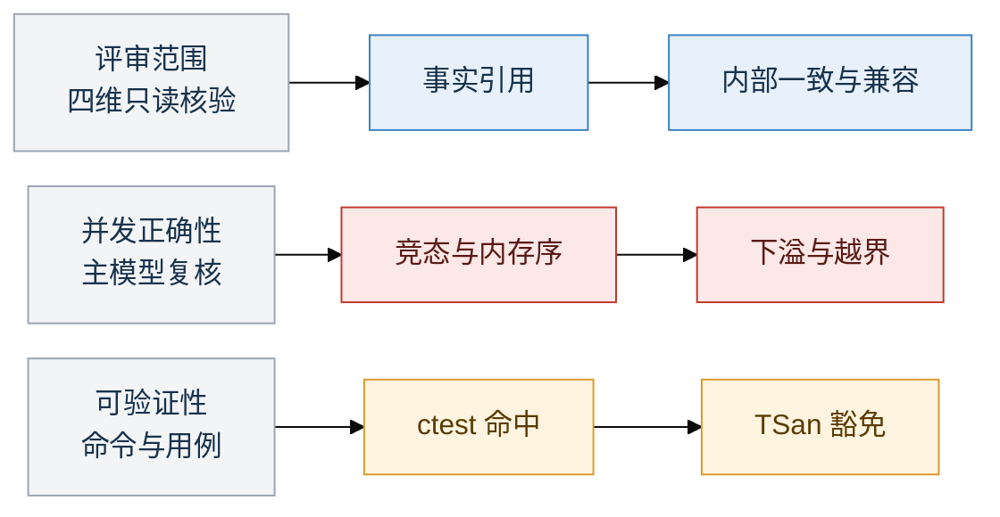

# 共享内存通信安全增强方案评审意见

> 评审对象: `docs/design_shm_comms_safety_zh.md`（版本 0.1，状态「方案待评审, 未实施」）
> 评审日期: 2026-11-16
> 评审结论: 不通过，需回炉一次后重新评审
> 复核: 2026-11-16，设计已修订为 0.2，结论仍为待复审
> 代码基线: `newosp` 0.9.3，编译标准 C++17（`CMakeLists.txt:14` `target_compile_features(osp INTERFACE cxx_std_17)`）
> 评审性质: 只读评审，未修改任何源文件，未执行构建与测试

## 0. 结论先行

评审结论为**不可直接实施**。方案的问题域拆解（数据面、控制面、等待面分离；显式代际校验；futex 等待面）成立，对现状缺口的识别方向正确；但存在 4 项阻断级缺陷，其中 2 项会使方案用来证明安全性的机制本身失效。

| 严重度 | 数量 | 性质 | 代表问题 |
| --- | --- | --- | --- |
| 阻断 | 4 | 实施前必须修复，否则安全属性不成立 | `read_guard` 检查-执行竞态；`WriteableBytes()` 无符号下溢；错误码语义与「不改变既有签名」互斥；布局版本升级影响面被低估 |
| 高危 | 8 | 实施前必须定稿，否则实现与验证同时失真 | futex 错误码映射；`WaitReadable` 迟唤醒；广播语义被破坏；64 位 `generation` 跨进程原子性；stale 判据误杀；恢复 API 未定义；错误码枚举重排；验证矩阵不可执行 |
| 中低 | 9 | 实施期可补，但影响可维护性与可核验性 | 状态机缺口；默认策略冲突；ID 空间未映射；行号偏差；范围声明不一致 |

本评审的判定依据是三条可验证承诺能否成立：死消费者在有界时间内被检测并回收；生产者能在有界次数内恢复写入；所有等待与扫描都有上界。按当前文本，这三条承诺在默认配置下均不成立（见 3.1、4.5、4.8）。



## 1. 评审方法与证据基线

评审分四个维度并行核验，全部为只读任务，主模型对关键结论独立复核：

| 维度 | 核验内容 | 主模型复核的结论 |
| --- | --- | --- |
| 事实引用 | 文档引用的符号、行号、配置值是否存在且一致 | 抽样复核 8 处，全部一致；发现 2 处行号偏差 |
| 并发正确性 | 内存序、竞态窗口、futex 协议、回绕与下溢 | 复核 B1、B2 两条阻断项成立 |
| 内部一致性与兼容 | 章节间矛盾、既有 API 与枚举、迁移承诺 | 复核 B3、B4 与 4.7 成立 |
| 可验证性 | 用例可写性、构建命令、sanitizer 门禁、发布口径 | 复核 4.8 的 ctest 与 TSan 两条实测成立 |

本文所有代码引用采用 `文件:行号` 格式，基线为评审时刻的工作区状态。文档自身引用采用 `§章节（原文行号）`。

## 2. 现状核验：文档对代码的描述基本属实

P0-0 描述的两条缺陷在源码中可复现，不是推测。

| 文档原文 | 核验结果 | 证据 |
| --- | --- | --- |
| §2「`total = len + 4` 可整数溢出绕过容量检查」 | 属实。`len = UINT32_MAX-3` 时 `total` 回绕为 0，容量检查恒通过，随后以该长度执行 `memcpy` | `shm_transport.hpp:942`、`:948`；SPMC 侧 `:1403`、`:1409` |
| §2「零长度消息不推进 tail」 | 属实。写侧允许写入 4 字节零长度头，读侧 `msg_len == 0` 直接返回，tail 不前进 | `shm_transport.hpp:977`、`:982`、`:986` |
| §2「注册窗口内 `active=1` 早于 tail 初始化」 | 属实。CAS 置 1 在前，写 `tails[i] = head` 在后 | `shm_transport.hpp:1371`、`:1374` |
| §7「`TryPop` 未校验 `slot.size`」 | 属实。按不可信长度 `memcpy` | `shm_transport.hpp:550`、`:566` |
| §2、§5.1 引用的其余位置 | 属实 | `:1367`、`:1481`、`:1691`；`data_dispatcher.hpp:808`、`:1263` |

偏差与缺项：

1. 行号偏差 2 处：§2 的 `941` 实际为 `:942`，`978` 实际为 `:977`；§5.1 的 futex 三函数在 `:1057`、`:1066`、`:1072`（文档写 1058，落在 `FutexWait` 函数体首行）。SPMC 侧的同构位置文档未给出（`:1403`、`:1443`）。
2. §2「写侧等待」只列出 `WaitReadable`，实际仓库有三处，其中 `shm_transport.hpp:766` 是轮询加指数退避实现，非 futex，文档未区分。
3. §7「`ShmSpscByteRing` 和 `ShmSpmcByteRing` 共用同一套校验函数」与现状不符：当前是两份独立实现（`:941-988` 与 `:1402-1454`），没有共享 helper。
4. 文档当成既有能力引用的符号在代码中不存在：`ResetAfterQuiesce()`、`Reopen()`、`RevokeConsumer`、`DataBlock::reader_mask`、`space_seq`、`reap_epoch`、`writer_token`、`read_guard`、`generation`（`shm_transport.hpp` 全文零命中）。`CreateOrReplaceWriter`（`:678`、`:1142`、`:1611`）、`owner_pid`（`:121`）、`IsProcessAlive`（`:172`）确实存在，引用正确。
5. 文档 §4.1 称「`layout_hash` 覆盖新增字段尺寸」不成立：`ShmLayoutHash` 只覆盖 64 字节 `ShmLayoutHeader`，`ShmSpmcByteRingHeader` 的新增字段尺寸无人校验。
6. 配置值核对一致：`OSP_SHM_SPMC_MAX_CONSUMERS = 8`（`opt.hpp:156`）、`OSP_JOB_MAX_CONSUMERS = 8U`（`opt.hpp:230`）、`OSP_JOB_CONSUMER_TIMEOUT_US = 3000000U`（`opt.hpp:353`），与 §4.3 的「`T_stale` 默认 3s」一致。

## 3. 阻断项（4 项，实施前必须修复）

### 3.1 `read_guard` 是检查后执行竞态，§4.5 的代际校验不能闭合该窗口

**原文**。§4.3（原文 142 行）：「只对 stale 且 `read_guard[i] == 0` 的槽位执行 CAS `active 1 -> 3`」；§4.3（原文 131 行）消费者第一步 `read_guard[i].fetch_add(1, acq_rel)`；§4.5（原文 190 行）：「`Read` 在取数据前校验 `active[id] == 1` 且 `generation[id] == handle.generation`」。

**问题**。写者序列是「读 `read_guard == 0` → CAS `active 1→3`」，消费者序列是「校验 `active`/`generation` → `fetch_add(read_guard)`」。两条序列之间没有共享原子量构成 happens-before：写者对 `read_guard` 是纯读，与消费者的 RMW 之间只有修改顺序；写者的 `active` CAS 与消费者的 `active` 读之间也没有同步边。因此存在合法执行：

1. 消费者校验 `active == 1`、`generation` 匹配，通过。
2. 写者读到 `read_guard == 0`，CAS `active 1→3` 成功。
3. 消费者 `fetch_add(read_guard)`，开始拷贝 payload。
4. 写者执行回收：`tail[i] = head`、`generation[i] += 1`、`active[i] = 0`。
5. 消费者提交 `tails[idx].store(old_tail + len)`（`shm_transport.hpp:1452`），用过期 tail 覆盖写者写入的 `tail = head`；槽位被新消费者复用后，该迟到的 store 还会覆盖新消费者的 tail。

§4.5 的校验与 `read_guard` 递增分离，无法闭合该窗口；任何内存序都改变不了这个**顺序**。§4.3 与 §4.5 对消费者步骤的描述本身也不一致（一处先加 guard，一处先校验）。

**危害修正**。拷贝区间恒在 `head` 之下，生产者的新写从 `head` 起，二者不重叠，因此「覆盖正在读取的 payload」不是真实危害（环形回绕场景的例外见 8 节勘误）。真实危害是 tail 的世代混淆及其派生的无符号下溢（见 3.2）。§8（原文 343 行）的 SR-03 应改写为「回收不得产生跨世代的 tail 写」。

**建议改法**。二选一，均不改变布局语义：

- 方案 A（推荐）：把 `state` 与 `guard` 打包进同一个 32 位原子字（新增 `std::atomic<uint32_t> slot_state[N]`，低位为 state，高位为 guard 计数）。消费者进入时 CAS `{state=1,guard=g} → {state=1,guard=g+1}`，失败且 state 不为 1 即返回 `kEvicted`；写者回收时 CAS `{state=1,guard=0} → {state=3,guard=0}`，guard 不为 0 则 CAS 失败，本周期 defer。两个 CAS 作用于同一字，天然全序。`static_assert(std::atomic<uint32_t>::is_always_lock_free)` 已在 `shm_transport.hpp:1279` 成立。
- 方案 B：写者改为 CAS 之后查 guard，消费者改为加 guard 之后重校验 state，四处操作用 `seq_cst`。在 seq_cst 全序下只有两种可能：消费者先进入则写者 CAS 失败，写者先进入则消费者读到非 1 状态并中止。

两种方案都要求补充消费者侧硬规则：拷贝结束后、提交 tail 前重新校验 `state` 与 `generation`，失效则丢弃结果、不提交 tail、返回 `kEvicted` 并计入 `evicted_total`。

### 3.2 迟到 tail 提交触发 `WriteableBytes()` 无符号下溢，可覆盖其他活跃消费者的数据

**原文**。§4.1（原文 105-114 行）只声明「内存上界不变」；§7（原文 300-321 行）处理长度溢出。全文未出现 `WriteableBytes` 的下溢，也未出现不变式 `0 <= head - slowest <= capacity`。

**问题**。`shm_transport.hpp:1418` 为 `return header_->capacity - (head - slowest);`，无下溢防御。两条可达路径：

- 路径一（基线已存在）：`:1371` 先把 `active` CAS 为 1，`:1374` 才写 `tails[i] = head`，生产者可在该窗口读到 `active == 1` 与上一代残留 tail。当所有消费者曾注销过时，`SlowestTail`（`:1481`）不再限制生产者，`head` 可远超 `capacity`；此时新消费者注册，生产者读到残留 tail，`head - slowest > capacity`，`:1418` 下溢，返回接近 2^32 的可写字节数。
- 路径二（3.1 派生）：旧消费者迟到提交 tail 把槽位 tail 回退，槽位复用后同样触发下溢。

**结论**。路径二说明 §4.2 的三态注册不能独立消除下溢。此不变式是 SPMC 防覆盖语义的唯一支点，应升级为 P0，与长度校验同级。

**建议改法**。新增不变式一节，明确 `0 <= head - slowest <= capacity` 恒成立，并加防御性钳位：

```cpp
const uint32_t used = head - slowest;
return (used >= header_->capacity) ? 0U : (header_->capacity - used);
```

`ShmSpscByteRing::WriteableBytes()`（`:954`）同样加钳位。§4.3 补充「任何推进或回退 `tails[i]` 的路径都必须保持 `tails[i] >= head - capacity`」。

### 3.3 错误码语义与「不改变既有签名」互斥，且代际校验缺少参数载体

**原文**。§7（原文 304-311 行）要求写入返回 `kInvalidArgument`/`kMessageTooLarge`、读取返回 `kCorrupt`；§4.5（原文 190 行）要求读取返回 `kEvicted`；§13（原文 521 行）却写「`Health()` 和 `ReadLease()` 是新增 API，不改变既有签名」；§10 的新增方法表（原文 429-437 行）未列任何签名变更。

**问题**。现有签名为 `bool Write(...)`（`:941`、`:1402`）、`uint32_t Read(...)`（`:1430`、`:1685`），无法承载上述错误码。更硬的冲突是：§4.5 要求 `Read` 校验 `generation[id] == handle.generation`，而现有 `Read` 只收 `consumer_id`，没有句柄参数，代际校验在现有签名下不可实现。另 `:1446-1449` 在 `msg_len > max_len` 时会跳过消息并推进 tail，与 §4.5「不推进 tail」相反。

**建议改法**。在 §13 明确二选一并写死：新增 `expected<uint32_t, ShmError> ReadChecked(ConsumerHandle, void*, uint32_t)` 与 `expected<void, ShmError> WriteChecked(const void*, uint32_t)`，旧 API 保留为 deprecated 包装（符合 `design_minimal_safety_optimization_zh.md` 中「旧 API 保留一个版本」的要求）；或承认这是源码不兼容变更，并在 §10 补写新签名。同时补 `UnregisterConsumer(ConsumerHandle)` 的幂等语义（`:1383` 现为 `void UnregisterConsumer(int32_t)`，按 `active` 由 1 变 0 计费）。

### 3.4 布局版本升级是全局动作，影响面被低估

**原文**。§4.1（原文 83 行）与 §7（原文 321 行）把 `kShmLayoutVersion` 从 1 升到 2；§13（原文 515-516 行）只声明「旧段 attach 返回 `kLayoutMismatch`」。

**问题**。`kShmLayoutVersion`（`:109`）是单一全局常量，被 `kSlotRing`、`kSpscByteRing`、`kSpmcByteRing` 三种段共用（`:102-107`），`ValidateShmLayout`（`:157-169`）一视同仁，`ShmLayoutHash`（`:128-138`）也把它混入哈希。升到 2 会连带作废未改动的 MPSC slot ring 与 SPSC 字节环历史段，而 §13 未声明该影响面，也未给出端点停机清单。

另有两项与关联文档的冲突：关联文档 `design_minimal_safety_optimization_zh.md`（原文 5 行、550 行）要求「P0-b 涉及 ABI/API 与迁移，必须单独提交」「布局版本单独升级、旧 API 保留一个版本」，而本方案把版本 bump 混在 §11 S2 第 1 步内，§15（原文 560 行）又规定「布局 v2 不能原地回退到 v1」。

**建议改法**。二选一：改为按 kind 分版本（在 `ShmLayoutKind` 内增版本位或头部内增 `kind_version`），把影响面限制在 SPMC，并在 §13 明确「MPSC 与 SPSC 段不受影响」；或保留单一常量，在 §13 明确「升级后所有历史段 attach 均返回 `kLayoutMismatch`」，并把版本 bump 从 S2 拆成独立提交。§4.1 删去「`layout_hash` 覆盖新增字段尺寸」，改为「新增字段尺寸由 kind 版本或全局版本覆盖」。

## 4. 高危项（8 项）

### 4.1 §5.2 的 futex 错误码映射错误

§5.2（原文 249 行）：`if (rc != 0 && errno != EAGAIN && errno != EINTR) return error(kWaitInterrupted);`。`FUTEX_WAIT` 超时返回 `errno == ETIMEDOUT`，不在白名单内，正常超时会被映射为 `kWaitInterrupted`，与 §9（原文 362 行）和 §12（原文 487 行）期望的 `kTimeout` 冲突。

`FutexWait`（`:1057-1063`）只实现相对超时（以 `timeout_ms` 构造相对 `timespec`），与 §5.2 的「每次迭代重算剩余时间」写法兼容，不需要改实现。只需修正映射：区分 `EAGAIN`（值已变，重新检查谓词）、`EINTR`（重算剩余时间，不重置 deadline）、`ETIMEDOUT`（重新核对 deadline，到期返回 `kTimeout`），其余才返回 `kWaitInterrupted`。`RemainingMs` 应向上取整，避免 1 ms 级超时被截断为 0。

### 4.2 既有 `WaitReadable` 的等待顺序与 §5.3 相反，存在迟唤醒

§1.2（原文 38 行）声明「`WaitReadable` 保留」，§5.3（原文 259 行）把「先读 seq，再检查谓词，再以旧 seq 进入 `FUTEX_WAIT`」写成全等待面的统一约定，但既有实现顺序相反：`:1692` 先查谓词，`:1695` 后读 head。若生产者在两者之间发布消息，等待者会带着含新消息的 head 进入 futex，睡到超时。方案未安排修复该实现。

建议：在 §11 S3 中显式列出该改造项，并把 §12 补一条「写入与进入等待之间插入随机延迟，等待者在 1 ms 内返回」的用例。

### 4.3 §5.3 将 `head` 改为唤醒一个读者，会破坏 SPMC 广播语义

§5.3（原文 260 行）：「`WaitReadable` 使用 `FutexWake` 唤醒一个读者」。现有实现是 `FutexWakeAll`（`:1675`、`:1704`），SPMC 的语义是一条消息广播给 N 个消费者。改为唤醒一个后，其余消费者只能被下一条消息唤醒；若通道速率低于消费者读取周期，会出现消费者长期不被唤醒、tail 停滞、被 §4.3 判 stale 回收，即健康消费者被驱逐，与 SR-08 冲突。

建议：明确 `head` 为广播字，发布后必须 `FutexWakeAll`；`space_seq` 为计数字，唤醒一个写者即可（SPMC 单写者）；`consumer_count` 变化时用 `FutexWakeAll`。

### 4.4 64 位 `generation` 放入共享内存的定性错误，且类型不能按运行时选择

§4.1（原文 90 行）写「64-bit if lock-free, else uint32 + bound」，§14（原文 531 行）写「原子操作退化为库锁」，§14 未决项（原文 542 行）要求目标板实测。

三处问题：

1. 定性错误。非 lock-free 的 `std::atomic<uint64_t>` 在 32 位 Linux 上由 libatomic 的进程内锁表实现，锁表不跨进程共享，两个进程对同一块共享内存的 64 位原子操作互不可见，可能读到撕裂值。这是跨进程原子性不成立，不是性能退化。
2. 类型选择不可运行时决定。`generation[N]` 的类型决定 `sizeof(ShmSpmcByteRingHeader)`，而布局在 `InitAt`（`:1303`）时即固定；用运行时 `is_lock_free()` 决定会让不同运行实例产生不同布局，`layout_hash` 随之不同，互通失败。类型必须是编译期常量。
3. 回绕约束缺失。§14 只写「加回绕约束」，未定义约束，不可实现也不可验证。

建议：改为 `std::atomic<uint32_t> generation[N]`，并补 `static_assert(std::atomic<uint32_t>::is_always_lock_free, ...)`；回绕约束写成可检查的公式：单个槽位在两次写者观察之间的注册与回收次数小于 2^32；消费者持有句柄期间同一槽位的代数小于 2^32，实现上在 `generation[i] == UINT32_MAX` 时拒绝注册并走重建段路径。§14 该行改写为「非 lock-free 的 `std::atomic` 禁止放入跨进程共享内存」。

### 4.5 stale 判据把「空闲」当「死亡」，且环空时死消费者不可检测

§4.3（原文 140 行）：「tail 不变且 `head != tail`：计算停滞时长，大于等于 `stale_timeout_us` 时标记 stale」。

两个后果：

1. 空闲不等于死亡。注册后长时间不取数据的健康消费者，其 tail 恒定不变；当 `head != tail` 有积压且超过 `T_stale`（默认 3 s）即被判 stale 并回收，其数据被跳过（§4.3 原文 146 行 `tail[i] = head`），违反 SR-08。§4.3 末尾以「控制通道默认 `kNone`」缓解，但传感器分发通道默认 `kOnFull`（§13 原文 518 行），恰在最需要自愈的通道上误杀。
2. 环空时死消费者永不可检测。判据要求 `head != tail`；生产者停止写入后，死消费者的 tail 与 head 相同，永远不判 stale。§9（原文 354 行）的检测上界 `T_stale + T_reap` 仅在有积压数据时成立。

另：`T_reap` 与 `T_write` 是全文未定义符号。§4.3（原文 163 行）只定义了 `T_stale`、`T_reap_interval`、`T_grace`，而 `T_reap` 在 §0、§8、§9、§12 共出现 8 处。

建议：检测信号改为两级。`IsProcessAlive(pid[i]) == false` 立即判死；pid 存活且 tail 停滞大于 `T_stale` 只标记 stuck 嫌疑并上报 `consumer_stuck_total`，不驱逐。§0 的承诺按策略分述，`T_reap` 全文替换为 `T_reap_interval`，并定义 `T_write` 为单次写路径扫描耗时上界。

### 4.6 恢复动作 `ResetAfterQuiesce()` 与 `Reopen()` 是未定义 API

§7（原文 315、319 行）、§8（原文 328、335 行）、§9（原文 358 行）、§4.5（原文 190 行）反复引用两者，但 §10 的 API 表没有定义，代码中也不存在。`ResetAfterQuiesce()` 是 §8「退出 `Faulted` 只有两条路径」之一的唯一实现手段，缺定义即安全状态不可达。

建议：在 §10 补两者的签名与语义，并说明与 `CreateOrReplaceWriter` 的适用边界：前者原地重置（要求写者独占且所有消费者已注销），后者换段（`:295-310` 已实现 owner 存活返回 `kOwnerAlive`）。§4.5 的 `Reopen()` 应由库提供还是由调用方组合 `UnregisterConsumer` 加 `RegisterConsumer` 实现，需明确。

### 4.7 §10 的 `ShmError` 列表若按字面实现会重排既有值

现有定义在 `shm_transport.hpp:73-84`，共 10 个值（`kCreateFailed`、`kOpenFailed`、`kMapFailed`、`kFull`、`kEmpty`、`kTimeout`、`kClosed`、`kAlreadyExists`、`kLayoutMismatch`、`kOwnerAlive`）。§10（原文 368-382 行）只写「existing values unchanged」但枚举体从 `kInvalidArgument` 起排；若按字面实现，现值全部被重排，与注释及 §13「只追加」双重冲突。文档正文自己引用了被漏掉的码：`kFull`（§4.4、§9）、`kTimeout`（§5.2、§9）、`kOwnerAlive`（§9、§13）、`kLayoutMismatch`（§4.1、§9）。

另有两处：`kPoolExhausted` 与 `JobPoolError::kPoolExhausted`（`data_dispatcher.hpp:65`）语义重复，块池耗尽属块池错误域，§9（原文 360 行）却要求通道返回它；`kNotRegistered`、`kStaleConsumer`、`kLeaseExpired` 全文未被使用。

建议：§10 给出完整枚举并显式标注既有值与新追加值的边界；删除未使用的新增值，或补上使用点；块池耗尽一行改为由 DataDispatcher 返回 `JobPoolError::kPoolExhausted`。

### 4.8 §12 验证矩阵当前不可按文落地（三项已实测）

1. `ctest -R shm` 命中不到本方案主改对象。ctest 测试名等于 Catch2 用例名，`-R` 为大小写敏感正则。实测 `build_verify/tests/osp_tests-b12d07c_tests.cmake` 共 1351 条 `add_test`，小写 `shm` 命中 50 条，漏掉 22 条大写名，包含全部 `ShmSpmcByteRing:`、`ShmSpmcByteChannel:`、`ShmStore:` 用例。建议新用例统一小写前缀命名 `shm_safety - <场景>`，tag 用 `[shm][safety]`，跨进程追加 `[fork]`；权威入口用 Catch2 tag 过滤，`ctest -R` 改为 `-R "[sS]hm"` 或删去。
2. TSan 门禁对全部 fork 与崩溃类关键用例为空。项目约定 TSan 与 `fork()` 不兼容，需跳过（`CLAUDE.md:49`，`tests/test_shm_transport.cpp:991`、`:1577`、`:2154`），`tests/CMakeLists.txt:137-139` 将退出码 4 记为 SKIP。矩阵中 dead consumer、paused consumer、reap race、lease crash reclaim 全部依赖 fork，在 TSan 下一律 SKIP，而 §15（原文 550 行）仍把它们计入门禁。此外 TSAN 不建模跨进程共享内存，§4.3 的跨进程竞态在 TSAN 下不会报错，该项验证必须依赖真实 `fork` 多进程竞态测试。建议补一条不依赖 fork 的等价用例（线程内模拟僵尸消费者）让 TSan 真实执行，并在 §12 显式列出豁免清单。
3. oversize 失败基线是进程级内存破坏，写不成 Catch2 断言。目标在 mmap 区，ASan 不插桩，`UINT32_MAX-3` 的基线表现为 SIGSEGV 或堆破坏，整个测试进程被杀而非一条失败断言。建议拆成两条：主用例用 `capacity-3` 断言应返回 `kMessageTooLarge`（当前实现成功写入，得到干净失败）；`UINT32_MAX-3` 放入 fork 子进程，父进程断言子进程被信号终止（基线），修复后断言子进程正常退出且返回 `kMessageTooLarge`。

其余验证侧问题：§11 S0「先断言当前行为」与仓库「先 RED 后 GREEN」惯例相反（修复后用例仍绿，无法证明修复内容）；§12「误差小于 10%」在共享 CI 上不可测，且与项目刚放宽时序断言的先例冲突，宜改为单边下界；上界类期望缺活性下界与失败判据，实现不回收时会被外部超时掩盖；1 MB 租约基准在仓库无 CPU 时间测量设施、无构建运行命令、无容量与块池参数；块池 attach 用 `OSP_ASSERT` 校验版本（`data_dispatcher.hpp:407`），`platform.hpp:198` 下 NDEBUG 编译为空，Release 构建静默放行旧池，与 §13 的「返回 `kLayoutMismatch`」不符，且 §11 无对应任务项。

## 5. 中低项（9 项，摘要）

| 编号 | 位置 | 问题 | 建议改法 |
| --- | --- | --- | --- |
| M1 | §4.2、§4.3 | `active == 2`（registering）崩溃无回收路径，`Tick()` 只处理 `active == 3`；8 次注册崩溃即耗尽通道（`OSP_SHM_SPMC_MAX_CONSUMERS = 8`） | 增「`active == 2` 超 `T_grace` 视为注册中断孤儿，`CAS 2→0` 并递增 generation」；§9 补行，§4.6 状态机补边 |
| M2 | §4.3 | `active 3 -> 1` 回滚未写明用 CAS，若用 store 会复活已被回收的槽位 | 明确为 `compare_exchange_strong(expected=3, desired=1)`；generation 复核读用 acquire |
| M3 | §10、§13 | `ShmChannelConfig` 默认 `reap_policy{kOnFull}` 与 §4.3「策略必须由调用方显式选择」、§13「低层默认 `kNone`」三处冲突；「旧 `RegisterConsumer()` 保留为包装」等于旧 API 静默获得自动驱逐 | 结构体默认改 `kNone`；由 `ShmSpmcByteChannel` 构造时显式填入 `kOnFull`；旧包装固定使用 `kNone` |
| M4 | §10 | 既有 `RegisterConsumer()` 返回 `int32_t`（-1 表示满），新签名返回 `expected`，返回类型不同无法重载；受影响调用点包括 `shm_transport.hpp:1661` 与测试内 12 处 | 旧签名保持不变，新 API 另起名并在 §11 增加「更新 `OpenReader` 内部注册与 12 处测试调用点」任务 |
| M5 | §4.1 | `RequiredSize(capacity, max_consumers)` 与现有 `RequiredSize(data_capacity)`（`:1355`）不符；「内存上界不变」不成立，头部实增约 140 至 172 字节 | 公式改为按 `sizeof` 表达，给出头部增量上界 |
| M6 | §4.1、§8、§10 | `reap_epoch` 定义后从未使用；`writer_token` 无获取与释放协议；`flags[N]` 只定义 bit0 与 bit1 却要承载 `stuck` 与 `corrupt`；`Health()` 无状态字段，无法表达 `Faulted` 与 `kCorrupt` | 为每个新字段补「谁写、何时、内存序、谁读、内存序」；`reap_epoch` 给出用途或删除；`writer_token` 补协议；快照增加 `state` 与 `last_error` |
| M7 | §6.2、§10 | 租约方案与 DataDispatcher 现状三处未对齐：`ConsumerSlot::holding_mask`（`data_dispatcher.hpp:331-336`）已实现同关系位图；`MaxBlocks <= 64`（`:345`）是块数约束而非消费者数；通道消费者 id 空间与池消费者槽位 id 空间无映射定义；「超过 64 消费者回退」在 `OSP_JOB_MAX_CONSUMERS = 8` 下不可达 | 明确复用 `holding_mask` 或指定唯一权威位图；分开写两类上界；新增 id 映射小节；`RevokeConsumer` 标明归属类 |
| M8 | 头部、§11 | 头部「范围」未列 `shell_commands.hpp` 与 `docs/design_zh.md`（S5、S6 要改）；§11 无 `opt.hpp` 任务（新增 `OSP_SHM_WAIT_SPIN_US`、`OSP_SHM_ENABLE_LEASE`）；S6 的「7.5 节」未指明是 `docs/design_zh.md`（该节存在，位于其原文 1040 行） | 补全范围声明；在 S3、S4 增补 `opt.hpp` 任务；S6 写明文档名 |
| M9 | §1.1、§4.3、§4.4 | `kOnFull` 模式未定义谁在何时调用 `ObserveProgress`，自愈承诺可能落空；`OverflowPolicy` 与 `ReapPolicy` 声称正交，但 `EvictSlowConsumer` 与 `kNone` 组合无定义行为 | `kOnFull` 行补「由 `Write` 内部调用 `ObserveProgress(now_us)` 后再扫描」；配置校验拒绝非法组合 |

## 6. 修订路径（5 步，每步给出退出判据）

1. **定稿 API 契约**。包含 3.3 的目标签名、3.4 的按 kind 分版本、4.7 的完整 `ShmError` 枚举，以及 `ResetAfterQuiesce`、`Reopen`、`WaitWritable`、`WaitConsumers`、`ReadLease` 按归属类分组。退出判据：§7、§10、§13 三处不再互相矛盾，§10 覆盖正文引用的全部符号。
2. **修复并发硬伤**。按 3.1 选定打包字方案并实现 3.2 的不变式与钳位，补充「被驱逐后不提交 tail」规则、M1 与 M2 的状态机缺口。退出判据：多进程竞态测试能断言 `head - slowest <= capacity` 恒成立，且同一槽位在任意时刻只有一个有效 tail 写者。
3. **修正检测判据与等待面**。按 4.5 改为两级检测并统一时间符号，按 4.1 修正错误码映射，按 4.2 与 4.3 修正既有 `WaitReadable` 的等待顺序与广播唤醒。退出判据：`WaitConsumers` 的等待谓词与计数语义在 §5.2 明确，且 §12 新增用例能区分 `kTimeout` 与 `kWaitInterrupted`。
4. **重写验证矩阵**。每条用例给出目标断言而非现状描述，用例名统一小写前缀加 `[shm][safety]` tag，活性用例用 `Health()` 单调计数加自带 deadline 断言，oversize 用 fork 隔离，TSan 豁免清单显式列出，基准移出矩阵并单独定义测量程序与参数。退出判据：矩阵中每条用例都能在当前仓库内写成可执行断言。
5. **补齐迁移与发布**。§13 写明升级影响范围与端点停机清单，块池新增返回 `expected` 的 attach 校验，本次按 minor 版本（0.10.0）发布并在 `docs/changelog_zh.md` 增加「源码不兼容」条目，同步 `docs/design_zh.md` 7.5 节。退出判据：迁移回归用例（v1 段 attach 返回 `kLayoutMismatch`）纳入矩阵。

## 7. 范围外事项与说明

1. §6 租约（P1-2）依赖 S4 的块池接口改造，可与 P0 分开评审，不阻塞 S0 至 S3。
2. §16 的 P2 观察项不属于本次评审范围，本次未发现其中存在必须前置处理的问题。
3. 本评审未执行构建与测试，全部结论来自源码推导与既有构建目录中的 `ctest` 用例清单；凡涉及运行时行为的判断（3.1 的竞态执行序列、4.8 的用例命中数量）均已在文中标明证据位置，便于复核。
4. 评审时本地 `PATH` 未找到 `mmdc`，文中 Mermaid 未做渲染目视核验；已按项目 Mermaid 规则编写，即全局 `flowchart LR`、每行一条独立横向链、行名并入该行首节点、不使用子图 `direction`。复核阶段已用 `npx` 缓存中的 `mmdc` 渲染通过。

## 8. 评审勘误与复核结论

复核结论: 原评审的 4 项阻断、8 项高危和 9 项中低问题中，绝大多数成立，足以支撑「不通过、回炉」的结论。设计文档已按这些项修订为 0.2，待复审。以下 4 处评审表述需要勘误，2 处严重度需要调整。

| 项 | 原评审表述 | 复核结论 |
| --- | --- | --- |
| B1 | 「拷贝区间恒在 head 之下，二者不重叠，覆盖 payload 不是真实危害」 | 结论成立，危害分析不完整。环形回绕后写者仍可覆盖旧 payload 区域；正确修复是 `slot_state` 打包 state 与 guard，并在消费者提交 tail 前重校验 |
| M4 | 「返回类型不同无法重载」 | 不准确。旧 `RegisterConsumer()` 无参，新 `RegisterConsumer(const ShmChannelConfig&)` 带参，参数列表不同，可以重载；真正要避免的是给新接口加默认参数 |
| H8 | 「S0 与先 RED 后 GREEN 惯例相反」 | 不准确。设计文档写的是「先写失败测试」，本身就是 RED；问题在「先断言当前行为」表述含糊，应改为「断言目标行为并先失败」 |
| 2.4 | 「把未实现符号当成既有能力引用」 | 过度解读。设计文档状态是「方案待评审、未实施」，`Reopen`、`RevokeConsumer`、`space_seq` 是提案符号；成立的问题是 H6，即这些提案 API 未在 API 节定义 |
| B4 | 「连带作废未改动的 MPSC slot ring」 | 部分不准确。MPSC 在 P0-0 中计划增加 `fault_flags`，不是未改动；SPSC 才是被全局版本 bump 连带作废的段。全局影响面仍需显式声明 |
| H5 | 统一按高危处理 | 应拆分。存活慢消费者被误杀是高风险；空环死消费者主要是槽位泄漏，影响较低。设计 0.2 已用 pid 存活检查与 `evict_alive_slow` 分开处理 |
| M1 | 中低 | 应升为高危。默认 8 个槽位下，8 次注册中断即可耗尽通道，属于活性缺陷。设计 0.2 已补 `state == 2` 孤儿回收 |
| 7.4 | 本地未安装 `mmdc` | 复核环境可用 `npx` 缓存中的 `mmdc`。评审自身的 Mermaid 已渲染并目视通过；设计 0.2 的两张图也已渲染通过 |

设计 0.2 的主要修订:

- 第 4 节: `read_guard` 改为 `slot_state` 打包，补消费者提交前重校验、`state == 2/3` 孤儿清理、pid 存活检查、`evict_alive_slow`、`WriteableBytes` 钳位。
- 第 5 节: `head` 改为 `FutexWakeAll`，补 `ETIMEDOUT` 映射、`WaitReadable` 等待顺序修正。
- 第 6 节: 租约复用 `ConsumerSlot::holding_mask`，删除 `reader_mask` 与池版本 3，补 `pool_slot` 映射。
- 第 7 与 10 节: 明确旧 API 包装与 `WriteChecked`/`ReadChecked`/`Reopen`/`ResetAfterQuiesce`，完整列出 `ShmError` 既有值。
- 第 11 与 12 节: 拆出版本 bump 独立提交，重写验证矩阵，补 TSan 豁免、fork 隔离和基准运行方式。
- 第 13 至 15 节: 明确全局版本影响、迁移清单、完成定义和回滚策略。

复审建议: 下一轮只聚焦 4 条阻断项的闭环，以及验证矩阵能否在当前仓库内直接执行。其余中低项按设计 0.2 的修订逐条核对，不再重复展开。

## 附录 A：问题索引

| 编号 | 严重度 | 位置（原文行号） | 主题 |
| --- | --- | --- | --- |
| B1 | 阻断 | §4.3（142）、§4.5（190） | `read_guard` 检查后执行竞态 |
| B2 | 阻断 | §4.1（105-114）、§7（300-321） | `WriteableBytes()` 无符号下溢 |
| B3 | 阻断 | §7（304-311）、§10（429-437）、§13（521） | 错误码语义与签名承诺互斥 |
| B4 | 阻断 | §4.1（83）、§7（321）、§13（515-516） | 布局版本升级影响面被低估 |
| H1 | 高危 | §5.2（249） | futex `ETIMEDOUT` 错误码映射 |
| H2 | 高危 | §1.2（38）、§5.3（259） | 既有 `WaitReadable` 迟唤醒 |
| H3 | 高危 | §5.3（260） | 广播语义被破坏 |
| H4 | 高危 | §4.1（90）、§14（531、542） | 64 位 `generation` 跨进程原子性 |
| H5 | 高危 | §4.3（140）、§0（20） | stale 判据误杀与空环漏检 |
| H6 | 高危 | §7（315）、§8（328、335） | 恢复 API 未定义 |
| H7 | 高危 | §10（368-382） | `ShmError` 列表会重排既有值 |
| H8 | 高危 | §12（496-509） | 验证矩阵不可按文落地 |
| M1-M9 | 中低 | 见第 5 节表 | 状态机、默认值、范围、位图、命名等 |

## 9. 设计 0.2 复审记录

> 复审日期: 2026-11-16
> 复审对象: `docs/design_shm_comms_safety_zh.md` 0.2（复审后升为 0.3）
> 复审范围: 4 条阻断项闭环、验证矩阵可执行性、0.2 新增内容的内部一致性
> 复审方式: 只读核验源码与既有 ctest 清单；未执行构建与测试
> 复审结论: 通过。4 条阻断项全部闭环，验证矩阵剩 3 处可执行性缺口，已在设计 0.3 修订

### 9.1 阻断项闭环判定

| 阻断项 | 0.2 落点 | 判定 |
| --- | --- | --- |
| B1 guard 竞态 | 4.3 `slot_state` 把 state 与 guard 打包进同一个 32 位字，进入与回收 CAS 同一字；4.5 提交 tail 前重校验 | 闭环。两种交错只有「消费者先加 guard」与「写者先置 3」两种结果: 前者写者 CAS 期望 `guard == 0` 必失败，后者消费者 CAS 读到的 state 已不为 1，必然中止。tail 提交被 guard 保护，跨世代 tail 写不再可达 |
| B2 可写空间下溢 | 4.1 不变式 `0 <= head - slowest <= capacity`、钳位公式、SR-09 | 闭环。`head - slowest > capacity` 时回绕值被 `used >= capacity` 分支压回 0，不再返回接近 2^32 的可写空间 |
| B3 错误码与签名 | 4.5、7、10、13 明确 `WriteChecked`/`ReadChecked`/`Reopen`/`ResetAfterQuiesce`，旧 API 保留签名不变的 deprecated 包装；`ShmError` 既有 0 至 9 不变 | 闭环，附 1 项缺项: 10 节新方法表未列 `ReadLease` 与 `RevokeConsumer` 签名。已补 |
| B4 全局版本影响 | 4.1、13 显式声明三种 kind 的 v1 段全部 attach 失败、停机重建步骤；S1b 单独 ABI 提交 | 闭环。SPSC 被连带作废已作为显式迁移成本记录，不再隐含在「附加字段」描述里 |

0.2 还顺带关掉了 H4 至 H7: `generation` 固定 32 位并给出 `UINT32_MAX` 拒绝注册规则；stale 判据改为 pid 存活优先、存活慢消费者只标 stuck；`Reopen` 与 `ResetAfterQuiesce` 给出签名与前置条件；枚举既有值完整保留。

### 9.2 对本评审文档自身的事实核验

抽查 15 处可复核事实，14 处准确，1 处行号偏差，结论不受影响。

| 项 | 本评审表述 | 核验结果 |
| --- | --- | --- |
| ctest 基数 | 1351 条 `add_test`，小写 `shm` 命中 50 条，漏 22 条大写名 | 属实。小写 50、大写独有 22、合计 72，与 `grep` 计数一致 |
| TSan 豁免位置 | `CLAUDE.md:49`、`tests/test_shm_transport.cpp:991`、`:1577`、`:2154` | 属实 |
| SKIP 配置 | `tests/CMakeLists.txt:137-139` 把退出码 4 记为 SKIP | 行号错。实际为 `:152`（注释）与 `:157`（`SKIP_RETURN_CODE 4`），另有 `:178`、`:210`、`:235` 三处同类配置 |
| 头部增量 | M5「内存上界不变不成立，头部实增约 140 至 172 字节」 | 口径需改写。该数值按「保留 `active[N]` 再新增四组数组」计算；0.2 用 `slot_state[N]` 取代 `active[N]`，净增为 `12 + 12N`，N=8 时为 108 字节，`sizeof` 由 80 增至 188。设计已显式写明替换关系 |
| 其余 11 处 | `ShmError` 0 至 9、三 kind 共用 `kShmLayoutVersion`、`ShmLayoutHash` 只覆盖 64 字节头、`SlowestTail` 读 `active`、注册 CAS 早于 tail 初始化、`WriteableBytes` 无钳位、零长度不推进 tail、`WaitReadable` 先查谓词后读 head、`Write`/`Notify` 用 `FutexWakeAll`、`ConsumerSlot::holding_mask`、`MaxBlocks <= 64` | 全部属实 |

正文已回改 1 处表述: 3.1 的「覆盖 payload 不是真实危害」加注环形回绕例外，与 8 节勘误对齐。2.4 的过度解读、H5 的严重度拆分、M1 的升级已由 8 节覆盖，不再回改正文。

### 9.3 验证矩阵剩余的可执行性缺口

| 编号 | 问题 | 影响 | 0.3 改法 |
| --- | --- | --- | --- |
| R1 | `reap race` 标 `[shm][safety]` 且只有「循环 10k 次」 | 单线程循环不产生交错，用例恒通过，SR-10 实际未被覆盖 | 拆为 `reap race threads`（双线程加栅栏，TSan 可执行）与 `reap race fork`（真实跨进程，1k 次） |
| R2 | 正文承诺「线程内模拟僵尸消费者」给 TSan 执行，矩阵无对应行 | TSan 对 `slot_state` guard 协议的覆盖为零，`[shm][safety]~[fork]` 的通过没有证明力 | 增加 `zombie consumer thread` 行，断言标记 stuck、不覆盖、不丢数据 |
| R3 | `wait timeout` 上界写「上浮 20%」 | 100ms 基准在共享 CI 上 20% 余量不足，易抖动为假失败 | 改为单边下界加绝对上界 `timeout_ms + 200ms` |

另有两项不是缺陷，但 S0 前必须定实现手段: 损坏注入类用例需要测试侧按 `ShmLayoutHeader` 布局直接改写段内长度前缀与 tail，不新增测试专用 API；`writeable no underflow` 需要构造 `tails[i] < head - capacity` 的段状态，同样通过直接映射段完成，并先读回被改写的值证明注入生效。0.3 已写入。

### 9.4 实施期约束

以下四条不改变设计，但属于实现时必须保持的判定条件，违反任一条都会让 9.1 的闭环失效:

1. guard 递减必须用 CAS，不得用 store，否则会覆盖写者刚写入的 reaping 状态。
2. 消费者在提交前校验失败时不得写 tail，且必须计入 `evicted_total` 或 `read_conflict_total`，不能只返回错误码。
3. `kEvicted` 与「同一句柄并发读」必须区分: 前者是槽位已被回收，后者是调用方违约，混计会让驱逐统计失真。0.3 已把后者定为 `kInvalidState`。
4. 死进程回收路径允许在 guard 非零时置 `state=3`，前提是 `IsProcessAlive(pid)` 已为假且 generation 与观察值一致；其余路径一律要求 `guard == 0`。

### 9.5 后续评审安排

只对 S1b（布局 v2 与 hash 参数）和 S2（`slot_state`、回收、孤儿清理）做实现级评审，其余任务按任务契约验收。S0 的用例命名与 tag 以 0.3 的 12 节为准。
